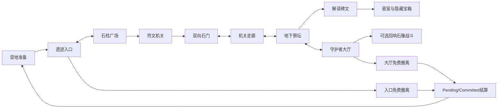

# 实际世界布局

新区域 AncientRuins 是既有游戏场景中的一个权威区域实例，五个逻辑区域不是五个流式 Scene。入口(0,176)、广场(0,202)、机关走廊(0,227)、祭坛(-12,253)、大厅(10,285)，平面单位米。地下祭坛地面-3米，其余0米；连续实心斜坡连接，台阶美术不承担阶梯碰撞。

四块80m、257采样TerrainData来自独立MapMagic免费核心编辑器生成（seed424242）。自有适配器整形及挖孔，自有石材地面、墙和模块构成实际探索路线。正式Player加载保存资产；Run seed控制确定性遭遇偏移与奖励身份，不声称每局重新生成Terrain噪声。

NavMesh使用真实地面网格和非通行碰撞体，agent半径.65m、高2.5m、坡度35度。高地背景保留TerrainCollider，不作为可游玩地面导航源。机关门和密室封石状态变化会重烘焙导航。实际CharacterController通行与导航规则分别验证；规则连通不冒充实际通行。

入口免费出口(0,171)，大厅免费出口(25,296)，均复用原有5秒撤离和中断/结算，不强制击败Boss。地下密室需要碑文，Boss为可选挑战。

地图新建模块的净空改进：拱门提高至7m，斜坡护栏随坡下降；祭坛南侧及密室入口采用真实2m采光矮墙，地下保留局部顶盖。这是可探索原型与既有连续相机碰撞的空间适配，不是完整封闭地下城精修。所有相应墙/栏Collider仍存在；导航收集事件底座。相机周围Terrain开孔扩展7m，地形远景仍保留真实TerrainCollider。最终三处正常跟随机位的SafePivot/arm几何误差为0，不能推导所有玩家机位已人工验收。

阶段3中间样本的恢复检查只证明未扩展区域/事件/遭遇及其奖励状态；不是已发行C1旧美术版本的逐值复刻。本批尚未发布的资产在验证中迭代，最终以冻结输入SHA为准。未来变更已发布C1-BAKED-1时必须保留旧资产解析，不能静默重解释旧在途Run。旧森林1–5布局不进入本生成器。
