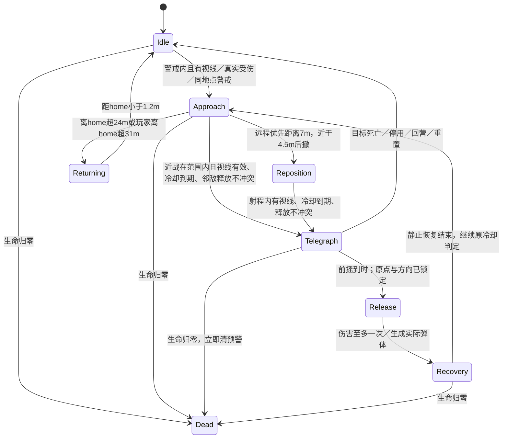
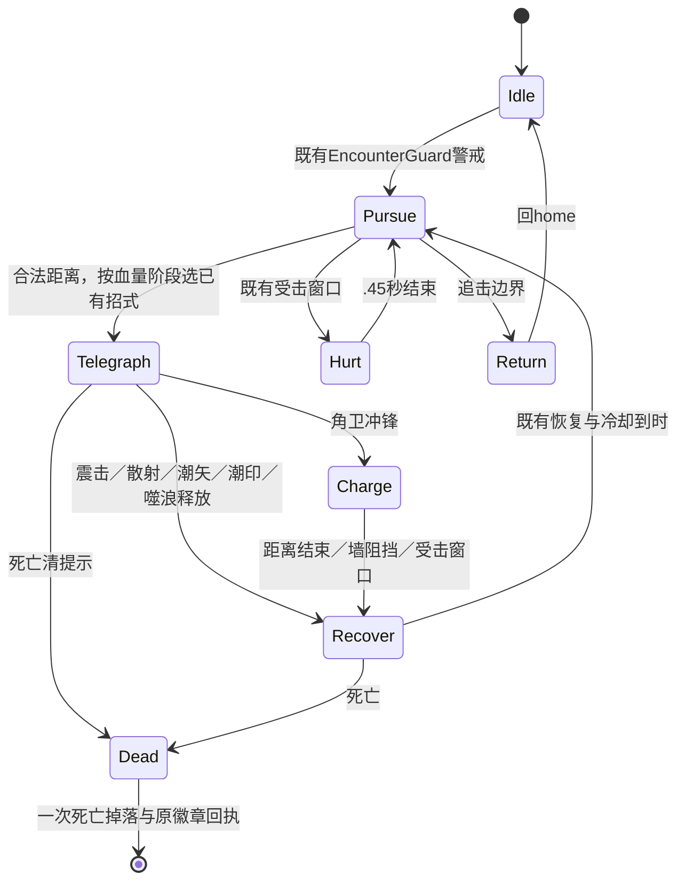

# 敌人状态、攻击窗口与取消规则

与开工源码及本轮实际负例对照，未将概念状态写成已实现功能。Patrol 当前不存在。

## 普通/远程/精英

原版同样有前摇与冷却，但没有方向扇区、显式静止恢复、邻敌错峰或初始警戒视线。普通释放后可立即追踪移动；远程只有4.5m以上才允许出招，被困近身时既退不出又不射击。

本轮只改变已复现的这些行为：

- 前摇原值 .65/.8/1.1秒不缩短。准备时锁原点/方向/目标点，停止水平移动。近战范围保持 attackRange+.15：普通1.85/精英2.75；方向半角75°/60°，地面扇区与判定共用同一角度和半径。释放仍查当前视线。没有穿墙伤害或背后360°命中。
- 远程仍以4.5～7m调整站位，但射程内有视线即可准备；.8秒预警后从锁定枪口发出，速度8、半径.16、寿命6秒不变。原始锁点不是持续自动瞄准。
- 邻近8m、同场景/同目标的普通攻击：比较正在前摇的释放时刻，间隔不足.24秒则暂缓准备。不是复杂战术AI，也不限制Boss自己的状态机。不保证所有敌群全局公平、不宣称最终围攻平衡。
- 静止恢复普通.35/远程.45/精英.65秒，包含在原释放后冷却1.3/2/2.1内，不另改伤害、HP或原总间隔。高防御下底伤问题仍保留，不能靠这项保证受伤量增加。
- 局部GameplayPaused但Time.time仍推进时，普通攻击期限随delta平移；真正timeScale0则自然冻结。目标恢复后保留余量，避免暂停菜单回来立即吃过期攻击。
- 释放门禁要求实际pending且已到时，消耗pending后才调用伤害；重复/过早公开回调不重发。死亡、停用、场景销毁清预警；材质每信号独立持有并销毁。敌弹主人死亡/停用、目标死亡或换场景时清理；暂停冻结移动、寿命及命中。玩家已释放弹体合同不改。

警戒限制：增加的是**首次看见**的视线检查。既有同POI呼援和受伤警戒保留；已警戒敌人仍在24/31m边界内追踪玩家当前位置，没有新增完整丢失目标/最后位置记忆系统。因此不宣称已消除所有遮挡追踪或完成潜行AI。

## 森林双Boss（本轮不改招式）

半血组合和六种攻击定义仍在ForestBossRules；ForestBossBrain仅在隔离副本临时包裹原调用做观测，不提交产品修改。旧BossBrain（波次Boss）也保留。不能把普通敌新枚举State当成Boss完整状态，Boss必须读取自己的State。

## 证据分层

Baseline 是真实Update的受控负例；Matrix 是真实启用AI、实际伤害/XP的短窗实验，但有初始teleport、装备/场地重置和关闭业务追踪，不冒充正常冒险、原生输入或人工。正常森林AI/存档/发行构建必须另列实际结果；视觉颜色/动态可读性需要真实画面和人工，不能由这张状态图宣称通过。
