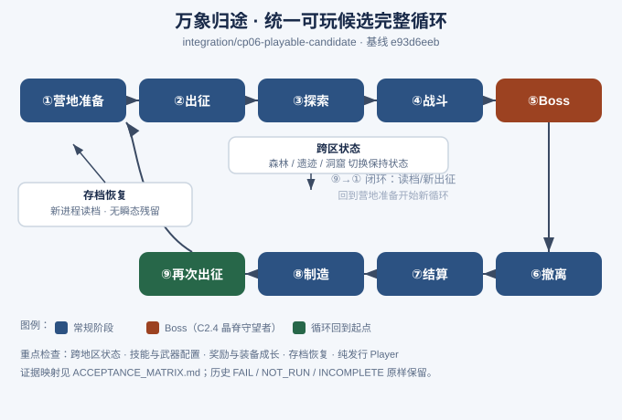

# CP06-INTEGRATION-01：完整循环状态图

> 图形文件：[STATE_DIAGRAM.svg](STATE_DIAGRAM.svg)
> 本图描述统一可玩候选的**完整循环**：营地准备 → 出征 → 探索 → 战斗 → Boss → 撤离 → 结算 → 制造 → 再次出征。
> 每个阶段下方标注其现有证据映射（详见 [ACCEPTANCE_MATRIX.md](ACCEPTANCE_MATRIX.md)）。

---

## 节点 → 证据映射

| # | 阶段 | 含义 | 现有证据（链接/目录） |
|---|---|---|---|
| ① | 营地准备 | 新游戏/继续、读取自动档、选择七武器 + 八技能配置 | `DeliveryCP06B`（七武器）、`DeliveryCP06A`（八技能）、`DeliverySkillState01` C5（读档 Selected 回槽 0）、`DeliveryCrystalCavernC22` C2.1（旧在途档读取） |
| ② | 出征 | 区域选择：森林 / 古代遗迹 / 水晶洞窟 | `DeliveryCrystalCavernC22` C2.1（森林与遗迹入口）、`DeliveryCrystalCavernC24B2`（洞窟入口） |
| ③ | 探索 | 区域内导航、C21/C22/C23 检查点、跨区状态保持 | `DeliveryCrystalCavernC22`（关门/桥/机关/宝箱）、`feature/cp06-crystal-cavern-c23` |
| ④ | 战斗 | 七武器普攻/默认技能对活体真实命中、扩展技能释放 | `DeliveryCrystalCavernC22`（七武器各自命中）、`DeliveryCP06A`、`DeliveryCP06B`、`DeliverySkillState01` C1/C2（法杖/弓） |
| ⑤ | Boss | C2.4 晶脊守望者：首奖、晶环实际接触、跨半血阶段 | `DeliveryCrystalCavernC24B1`（首奖/名称）、`DeliveryCrystalCavernC24B2`（收益投影/晶环接触）、`R1`（同 Run C05 10/10）、`R2`（晶环 25/27 PASS + 2 NOT_RUN） |
| ⑥ | 撤离 | 撤退返回、挑战失败返回、免费出口 | `DeliveryCrystalCavernC22`（实际撤离后新出征）、`DeliveryCrystalCavernC24B2`（不挑战可返回） |
| ⑦ | 结算 | 普通掉落拾取、首奖待领/领取、无重复预测 | `DeliveryCrystalCavernC24B2`（B2-01/02/03 无重复、首奖独立）、`DeliveryCrystalCavernC22`（铁矿/晶石采集、跨进程撤离入仓） |
| ⑧ | 制造 | 装备成长、新武器追加掉落材料入仓 | `DeliveryCP06B`（背包/仓库/品质接入）、`DeliveryCrystalCavernC22`（材料入仓） |
| ⑨ | 再次出征 | 存档恢复、新进程读档、回到营地开始新循环 | `DeliverySkillState01` C5（新进程读档无瞬态残留）、`DeliveryCrystalCavernC22` C2.1（旧在途档） |

---

## 重点检查项（本批次关注）

| 重点 | 对应节点 / 证据 |
|---|---|
| 跨地区状态 | ②/③：`DeliveryCrystalCavernC22` C2.1（森林/遗迹入口与在途读取）；切换区域不升级地图 |
| 技能与武器配置 | ①/④：`DeliveryCP06A`（八技能）、`DeliveryCP06B`（七武器）、`DeliverySkillState01` C5（Selected 回槽 0 设计限制） |
| 奖励与装备成长 | ⑦/⑧：`DeliveryCrystalCavernC24B2`（收益投影/首奖独立）、`DeliveryCP06B`（追加掉落） |
| 存档恢复 | ①/⑨：`DeliverySkillState01` C5（新进程读档）、`DeliveryCrystalCavernC22` C2.1（旧在途档） |
| 纯发行 Player | 全局：`DeliverySkillState01` A3-2（纯发行构建 errors=0、Boot=0）；完整手动循环原生试玩仍 `NOT_RUN`（见验收矩阵） |
