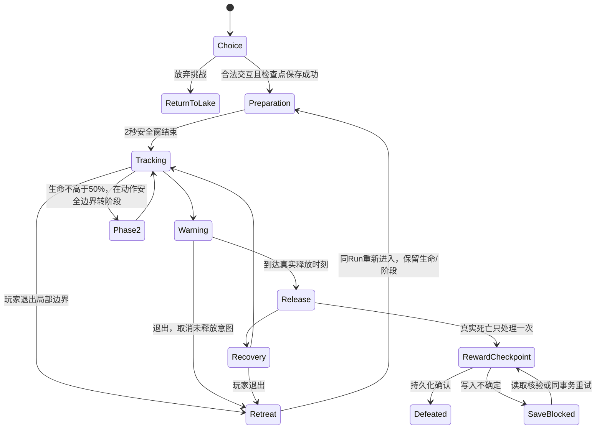

# CP06-C2.4-A：水晶洞窟 Boss 遭遇设计

状态：**仅文档，待下一次实施授权**。本阶段未运行 Unity、战斗测试、历史矩阵或构建；以下验收全部为计划，不填 PASS。

产品基准：`37b25bb641c72deefe4e7e48f19f270711f7fc01`。
设计分支：`design/cp06-crystal-cavern-boss`，直接从上述提交创建。开工远端 main 为 `72db192a527bd256e2ba18cd7ab334d8334051da`，不修改、不合并。开工设计工作树干净。本提交唯一新增本文件，不新增测试工具或产品资源。

## 0. 已有能力、缺口与保护

下列是对固定基准的源码阅读，不是本轮运行结论。源码链接相对本文件目录；历史结论只按原范围引用。

| 已有实现 | 可复用内容 | 新 Boss 尚缺的部分 |
|---|---|---|
| [CrystalCavernLayout.cs](../../../Assets/CombatPrototype/CrystalCavernLayout.cs) | C2.1=revision7/generation10，C2.2=8/11，C2.3=9/12；精确资源映射与快照校验 | 新内容版本、可选挑战支路和 Boss 稳定身份；现在没有洞窟 Boss |
| [CrystalCavernRegion.cs](../../../Assets/CombatPrototype/CrystalCavernRegion.cs) | 固定 Prefab、Collider/NavMesh、机关恢复、重建失败保留旧导航 | 新战场绑定、挑战边界、Boss 类型注册；不改旧桥事务 |
| [CrystalCoreElite.cs](../../../Assets/CombatPrototype/CrystalCoreElite.cs) | 晶壳/预警/暴露/恢复、真实伤害系数及协调窗口 | 这是 C2.2 精英，不是完整 Boss；不把放大精英视作新 Boss |
| [RuinsBossBrain.cs](../../../Assets/CombatPrototype/RuinsBossBrain.cs) | 独立状态、两阶段、预警、Overlap+遮挡校验、真实弹体与观测事件 | 仅参考组织方式；不继承遗迹招式参数，也不修改遗迹 Boss |
| [EncounterGuard.cs](../../../Assets/CombatPrototype/EncounterGuard.cs) | 导航和告警；既有脱战距离约24/31m | 距离阈值不能直接当洞窟安全边界，新 Boss 需局部边界规则 |
| [AdventureState.cs](../../../Assets/CombatPrototype/AdventureState.cs)、[RuinsSpecialRewards.cs](../../../Assets/CombatPrototype/RuinsSpecialRewards.cs) | Profile.profileId、specialRewards、pending；Earn/CompleteClaim/校验 | 当前特殊 ID 白名单和 Enabled 只接受遗迹；不能直接调用生成洞窟首奖 |
| [AdventureFlow.Bosses.cs](../../../Assets/CombatPrototype/AdventureFlow.Bosses.cs) | 死亡检查点、保存重试与不确定状态冻结 | 现有完整 Snapshot 比对是遗迹分支；洞窟必须接入完整死亡/掉落/回执核验，不能只比 Profile |
| [CombatEnemy.cs](../../../Assets/CombatPrototype/CombatEnemy.cs) | DropLootOnce、死亡处理、训练/遗迹分派 | 普通 Boss fallback 会给通用核心/装备；新 Boss 必须唯一分派，防止专用与通用双重发奖 |
| [CombatSaveSystem.cs](../../../Assets/CombatPrototype/CombatSaveSystem.cs)、[CombatSaveData.cs](../../../Assets/CombatPrototype/CombatSaveData.cs) | 捕获死敌前处理掉落；SavedEnemy 有身份/位置/生命/aiState；保存地面装备 | 无完整 Boss 攻击相位持久化；禁止把阶段塞进 EncounterGuard.aiState |
| [AdventureFlow.World.cs](../../../Assets/CombatPrototype/AdventureFlow.World.cs)、[AdventureFlow.cs](../../../Assets/CombatPrototype/AdventureFlow.cs)、[AdventureValidation.cs](../../../Assets/CombatPrototype/AdventureValidation.cs) | 营地 CommitChange、Pending/Committed、唯一提交、档案校验 | 新特殊 pending 的领取、禁止弃置、出征条件和校验须一起注册 |

C2.3 已被用户在约定原型范围接受，属于**带开放项内部开发检查点**。地下湖、两岸、回程桥、物资恢复和旧版本隔离不重做。保留近战晶柱遮挡配对缺口；保留原生输入、人工体验、平衡、性能及历史构建问题原状态。C1/R7 原统计和历史严格像素 FAIL 不重写。本阶段不发起 R8 或全量历史复跑。

冻结 CP04 CombatAim、CP05 TargetAssist/OrbitCamera/CameraActorFade、七武器基础数值、现有技能、旧地图奖励、随机流和 PRIVACY-A。不购买素材；暂定复用现有猫科刚性分件与晶体材质，新增动作质量缺口留给实施前素材检查，不能宣称已有完整骨骼动画。

## 1. 玩家在哪里决定挑战或撤离？

### 1.1 地图关系与选择点

Boss 暂名 **晶脊守望者**。它守卫湖东侧独立晶室，既不守桥也不守免费出口。下图为北向上、非比例示意：实线为现有路线，点线为拟新增支路。坐标是候选制作范围，必须在新版本固定资源内落地并验证，不能拿图代替通行证据。

```text
                                北岸 z432（较长、无新增巡守）
                       ┌──────────────────────────────────┐
                       │                                  │
营地 ← 免费出口        │           地下湖                 │ 对岸 x78,z410
(0,384)←原矿区/通道←西岸x40────[原回程桥，机关开启]─────────┤ 原机关/宝箱保留
                       │                                  │
                       └────南岸 z394（原普通巡守）────────┘
                                                          ·
                                             新支路/转角 x84..98
                                                          ·
                                             [挑战前室：选择点]
                                          返回湖岸 ←  │ → 交互“挑战守望者”
                                                      ·
                                    实体折角墙/通道，不设锁门
                                                      ·
                                    战场 x98..130,z392..430
                                    [开阔核心区；Boss锚点约116,410]
                                    ← 原路退回前室/湖岸
```

新资源候选：`CrystalCavernC24/Cavern`。选择前室约 x86..94,z416..423，通道净宽候选6–8m、净高至少9m，战场净高候选12m。湖岸 x78 的机关和宝箱不挪动；C2.3 现有东墙不能直接删改，制作的是新版本资源中的独立开口及扩展空间。折角墙隔断前室到 Boss 的直线视线，同时保留身体、NavMesh、肩后相机的真实空间。

选择点只给一句情境提示：“晶室挑战可中途退回；普通战利品需撤离带回，首次纪念奖励记录于档案。”显示当前已携带收益、免费出口方向和是否已首杀，不弹中心长文。不消耗材料，不要求武器或钥匙，不强制先开桥。不开桥也能沿任一原岸路返回；桥已开则可走捷径。新 Boss 不锁桥、不开关原出口、不向湖岸生成危险区或增援。

### 1.2 进入、脱战、死亡和重新进入

| 边界 | 候选产品规则 |
|---|---|
| 首次进入前室 | Boss Idle，不自动进入战斗；原有湖岸敌人仍遵守原规则，因此“前室选择点”不冒充全地图绝对安全 |
| 主动挑战 | 合法近距交互产生新 Run 内 `c24:boss:challenge` 事件。先保存参与状态/同一 Boss 身份，再进入 Tracking，至少2s无伤准备；保存失败不启动攻击，不发奖励，可重试或返回 |
| 战场入口 | 通道始终可返回，不设封锁玩家的空气墙/战斗锁门。未挑战的 Boss 不可被提前攻击以绕过状态；拟用明确可见的静止封晶表现，挑战后撤去，只作用新 Boss |
| 主动脱战 | 玩家退出战场边界并越过折角返回线，取消未释放意图，Boss走回自身锚点、不越过入口追到湖岸。已释放弹体仍按真实碰撞/寿命结束，不因 AI 禁用提前抹去威胁记录；提示残余弹体未消退，不能声称迈过线立即无敌 |
| 遮挡安全 | 折角真实墙体挡住既有弹体和下一轮视线；前室不能直接射中 Boss。必要时优先调整新通道尺度/折角，不改 CombatAim、不靠删 Collider 或忽略墙层解决 |
| 脱战后重入 | 同一 Run 同一 Boss、保留当前HP和由HP决定的阶段，不回血、不刷常规奖励。再次越过挑战入口时给2s安全准备，取消旧前摇；可逐步消耗 Boss 的策略属于候选规则，需实测平衡，不隐蔽重置玩家物资 |
| 玩家死亡 | 使用现有 Death→Pending→Committed 路径。按既有规则处理携带收益损失；不得直接重开或给补偿。已持久化首奖回执不因随后死亡删除；普通地面未拾取物不自动保底入仓 |
| 已击败后重新进入 | 同一 Run Boss 保持死亡，未拾取奖励按原身份恢复，不复活、不重发；新 Run 可再次挑战并获得常规掉落，首奖不再重复 |
| 暂停/卸载 | 暂停冻结计时、移动、预警和命中；死亡/场景卸载按明确生命周期取消未释放攻击、销毁本遭遇瞬态对象；恢复/重新进入不会补发旧攻击 |



图为设计，任一可伤害状态均可因真实死亡进入终态，不局限于图上的 Release 箭头。

## 2. 两阶段分别要求玩家做什么？

### 2.1 战术与阶段合同

第一阶段要求玩家识别**朝向扇形与直线弹道**：贴身玩家侧移到背侧，在收招期攻击；远程玩家横向移动避开定向齐射，避免持续站桩。没有武器免疫、强制换武器或必须命中微小弱点的门槛。

第二阶段要求玩家识别**前后两次锁定与内外安全区**：不要看到一次释放就贪完整连段；斜切裂线、进入环形安全内圈或退出外圈，再利用明确恢复窗。两种新增招式不是仅加快第一阶段或提高伤害。

候选生命360，移速2.1m/s。只作用新 Boss，不改变已有敌人。生命首次 ≤50% 时：已开始招式按启动时的阶段参数完成，待恢复结束再播放1.2s无伤碎壳转换；不临时缩短当前前摇，不销毁已释放弹体。转换后阶段2不回退。无回血规则，因此存档阶段可由已保存HP确定，不新增布尔阶段字段或借用 aiState。加载时HP≤阈值直接进入阶段2的安全准备，不重播会伤害玩家的转换，也不补发原招式。

初始候选循环：阶段1“晶爪扇扫→晶矢齐射→晶爪扇扫”；阶段2“交叉裂线→晶矢齐射→空心晶环→晶爪扇扫”。招式不可用时只追踪/等待，禁止退化为无冷却连发。范围外不会凭空命中，等待不增加旧随机流调用。独立固定循环可复现，不用 Rewards/Placement/Events 选择招式。

### 2.2 候选招式表（非最终平衡）

伤害均为**送入现有伤害入口前的候选原始值**，实际生命变化仍由现有护甲/防御/翻滚规则决定。范围以地面中心、目标真实 Collider 与遮挡检查共同约束；不是只测角色点，也不是用预警 Renderer 触发伤害。

| 招式/阶段 | 可见预警与锁定 | 实际命中几何 | 规避方向 | 反击窗口/候选时序与伤害 |
|---|---|---|---|---|
| 晶爪扇扫 P1/P2 | 抬起外侧晶爪，地面120°扇形边线及扫掠箭头；1.20s。前0.45s有限转向，随后固定，预警同步 | 半径3.6m、半角60°、垂直差≤1.6m，真实Overlap与合法目标过滤；Boss至接触点不能穿墙；一次释放对同目标一次 | 向扇形侧外/后方，或后退离开半径；禁止释放瞬间追转 | P1原始16，恢复1.35s；P2原始18，恢复1.05s。恢复期不新追踪/伤害 |
| 晶矢齐射 P1/P2 | 杖状前爪聚能，显示3条实际发射方向，1.35s；后0.60s不追踪，固定瞄准点 | 真实发射点约1.6m高；3发±12°弹体，候选速度8m/s、半径0.18m、最长18m/2.25s，真实初始重叠/SphereCast/首次碰撞；每发自身只命中一次 | 横移穿离当前射线，或借真实柱墙挡弹；不要求在准星中心精确识别小点 | P1每发10，恢复1.40s；P2每发12，恢复1.15s。允许不同箭分别命中但总数≤3，需评估近距多发同中；发射点/初始重叠不得跳过 |
| 交叉裂线 **P2专属** | 先亮第一条斜向长条1.50s；释放后第二条以不同箭纹显示1.10s预警，两次区域分别固定，不在最后一帧追踪 | 每条长8m、总宽2.4m、向前矩形，瞬时0.12s命中窗；两条方向相对初始朝向±25°；OverlapBox+视线遮挡，每条独立attackId去重 | 垂直跨出第一条，再观察第二条，向未覆盖侧移；不以第一击结束当成完整恢复 | 每条原始20。第二击后1.65s完整恢复；不能把“等待第二击”算作可放心反击的恢复窗 |
| 空心晶环 **P2专属** | Boss下压双爪，地面明确内外两条边界，环面纹理/径向箭头；1.60s，中心在开始时固定 | 内半径2.2m、外半径6m、垂直差≤1.2m；实际环带Collider接触与遮挡校验，单次伤害窗0.15s；不是整圆无条件伤害 | 已贴身可留内圈；中距离向内或向外，外圈玩家保持外侧。跨边缘按实际Collider判定，不能承诺中心点在线外就绝对安全 | 原始22，恢复1.80s。内圈可近战反击，外侧远程可射击；不强制玩家冲到近战距离 |

P1额外恢复后间隔候选0.75s；P2为0.55s。它是**恢复完成到下一次前摇开始**的间隔，不是每击间隔。以连续扇扫为例，释放到下次释放最少3.30s（1.35+0.75+1.20）变为2.80s（1.05+0.55+1.20），仅说明候选频率变化；真实循环含齐射、裂线和环，必须测整个周期，不能宣称所有P2招式更频繁。P2扇扫16→18、齐射10→12，专属20/22均须配对观测实际护甲后伤害。暂不新增击退/破甲、持续DoT、召唤怪或全屏湖水攻击。

合理规避窗口以“方向冻结→真实释放”的剩余时间、角色实际移速/翻滚、目标到安全边界距离和碰撞半径测量，不拿表中前摇总时长充当有效窗口。不得为平衡测试改玩家生命、防御或移动规则；合成配装只能在测试开始前登记。

协调：Boss与已释放弹体必须进入现有威胁协调体系；既有前摇中禁止叠加新攻击，已释放威胁不能因只禁用AI被清空。战场不新刷小怪；原能量通道危险区在地图另一端，不移入Boss厅。若原巡守可能被引入入口，先以新地图空间、局部遭遇边界和现有协调检查处理，不能冻结旧AI制造安全窗口。

### 2.3 贴身与肩后视线检查

**贴身例子（计划）**：长剑/双刃在Boss正前方约1.6m，镜头保持用户现有肩后参数。晶爪扫必须能同时看到至少一侧抬爪轮廓、外侧扇形边线和出口方向；脚下线被身体遮住时，用外缘连续纹理和手臂动作补充，不增加中央大字。玩家侧移/翻滚到扇外，真实避免伤害，然后在1.35s恢复窗实际攻击。晶环内圈不得因Boss模型投影完全不可见；优先缩减新Boss躯体宽度、增大新战场净空/避免背靠晶柱，不修改镜头或已批准技能范围。这个例子要分别记录命中与规避，不能只录像“看起来躲开”。

**肩后远程例子（计划）**：法杖6m及20m、左/中/右/Orbit机位瞄准；附近晶柱不允许遮住全部预警外缘。玩家对Boss有视线而真实杖首被晶柱挡住时，仍应被既有CombatAim及弹体碰撞挡住；不为改善命中把柱子设为非碰撞。记录相机、准星射线、实际枪口、目标Collider、首碰及生命变化。追加0.35m/1.5m沿用CP04近距合同；不存在合法目标时仍自由瞄准。弓以同样方式检查真实箭矢，不能用目标选择成功代替命中。

战场外围少量真实晶柱用于遮挡，但不摆在入口轴线和全部反击位；每个攻击至少留两条不穿过其他危险区的规避路径。固定肩后参数和实际Player画面才能验证，设计图不证明可读性。HUD仅沿用一个Boss生命/阶段条与短招式名；不锁镜头，不强制武器切换，不堆中心HUD。

## 3. 击败后如何发奖、读档？

### 3.1 两类身份与经济边界

候选新内容版本 `C2.4-CAVERN-1`、revision10、generation13、资源 `CrystalCavernC24/Cavern`，实施前重新核实未占用。保留Region=`CrystalCavern`与mapId；仅新建Run选择新版本。C2.1/2.2/2.3在途继续7/10、8/11、9/12及各自原Prefab，不能用 `revision>=9` 识别Boss内容。

| 类别 | 候选稳定身份 | 获取与持久化 |
|---|---|---|
| Boss实体 | `c24:boss:crystal-warden` | 同Run唯一实体；死亡与地面掉落同一检查点保存 |
| 挑战机关 | `c24:boss:challenge` | 真正场景交互，SavedWorldEvent.used表示本Run已激活；不是永久首杀，也不借机关记录奖励 |
| 永久首奖 | `c24.special.crystal-warden-first` | 唯一性键为Profile.profileId+SpecialRewardId；首奖生成1份既有模板的紫色镰刀纪念装备，名称/外观候选，不增加武器类型、词缀或配方；装备最终属性需下批核对已有工厂 |
| 首奖待领 | `c24.special.crystal-warden-first.pending` | Profile.pending一条，连同SpecialRewardReceipt{earnedRunId,claimed=false}写入；物品身份由Profile+SpecialRewardId稳定派生，与普通装备ID不同 |
| 常规掉落 | `(runId,regionInstanceId,c24:boss:crystal-warden,death)` | 候选晶石3–5、铁矿2–4、既有品质规则的一件普通装备；首版候选仅用NewWeaponRegistry.Create支持的双刃/巨剑/镰刀等权，品质白/绿/紫候选50%/40%/10%；均为新Boss独立规则，不把遗迹固定紫装规则误称洞窟既有规则 |

常规掉落是新内容新增供给候选，**不宣称经济不变**。不得从旧抽取池扣除收益抵消；不消耗旧Rewards/Placement/Events或Unity全局随机来选新Boss招式或表现。新Boss常规奖励建议复用 RuinsExploration.Identity/Hash 与 NewWeaponRegistry.Number/Create 的确定性来源派生模式（并不存在 AdventureRandom.Derive API）生成，生成时保存每件确定结果和ID；品质/词缀的整个调用链都必须检查独立性，不能只隔离第一步概率。需在下一轮审计实际工厂接入后批准参数，不在本轮伪造“已有掉落规则”。CP06-B独立追加武器通道是否适用新Boss要显式登记，首版建议不额外触发，以免重复供给；不得改变旧敌人适用范围。

首奖领取记录与物品持有不同：领取后丢弃、装备、转仓或拆解均不能清掉 claimed。新Run重复挑战仍给常规掉落，但不再创建首奖或pending。不同Profile各有独立领取权；不设计跨档案复制/导入合并功能。手工回滚整个旧档属于回档语义，本地存档不能承诺抵抗恶意文件回滚；应用正常流程、备份恢复必须保持回执一致。

### 3.2 原子发布与异常处理

1. 真实死亡进入唯一产品死亡入口。新Boss专用分派与通用Boss/森林/遗迹奖励分派互斥；`lootDropped`只是当前进程护栏，不能单独证明跨进程唯一。
2. 同一个检查点构造并保存：Boss死亡快照、挑战事件、全部常规地面掉落完整属性/ID与来源、首次永久回执及pending。调用既有原子写入，成功确认后再报告“已记录首奖”。存档写入期间冻结结算/领取入口，不能先发奖后补死亡快照。
3. 写入失败保留同一内存事务和已生成结果，重试不重新抽取。结果不确定时，完整读取并核对Profile、Run、实体、地面物品、回执和revision，不采用仅Profile相同就确认发布的捷径。读取中途失败保留恢复标记与读取入口。此扩展需单独审核 AdventureFlow.Bosses 的洞窟分支。
4. 首奖始终先进永久待领取，不因战斗现场满包而掉到地面；回营通过现有 `ClaimPending`/`Camp.CommitChange` 原子完成“插入背包或仓库+claimed=true+移除pending”。目标满、保存失败或重试时保留同一pending和物品；禁止弃置待领首奖，不复制到多个容器。
5. 常规掉落仍是地面→真实拾取→Run库存/来源账→撤离Pending→Committed→永久仓库。满包留在地面并按原规则保存，不把未拾取物品记为已带回；普通材料不进入永久唯一白名单。

| 保存/重启点 | 预期恢复合同（待实现测试） |
|---|---|
| 未挑战/已激活未开打 | 原版本、机关状态、Boss同一ID；未激活不自动开打 |
| P1/P2战斗中 | 保存实际HP/位置/合法遭遇状态；加载从无伤准备开始，阶段由HP决定；不恢复前摇命中、不重造已发弹体，不把aiState当阶段。瞬态弹体不入档是明确候选恢复规则，不称精确帧恢复 |
| 脱战后 | Boss剩余HP不重置，位置合法；原路、原桥与出口状态不变 |
| 击杀未拾取 | Boss死亡、全部地面物品原ID/属性、首奖pending同时恢复；不能只比较数量 |
| 首奖已领/已拆解 | claimed仍在且无重复pending；再次挑战或领取被拒绝，常规掉落不被封锁 |
| Boss击杀后玩家死亡 | 已确认永久首奖保留；普通收益走既有死亡损失；未确认保存按上次成功检查点/不确定冻结处理，不悄悄拼接新旧结果 |
| 撤离Pending | 同一结算身份和完整计划恢复，未提交收益不得展示为永久入仓；Boss回执已确认的部分不重复发放 |
| Committed未确认/已回营 | 读取同一提交回执；重复确认或重启不再入账；首奖领取另走营地事务 |

拟复用v9现有 `Profile.specialRewards/pending`、`SavedEnemy`、`SavedWorldEvent` 与 `SavedLoot`，**不预先新增字段**。现有遗迹专用白名单、pending识别、档案校验和出征判定都需小范围注册新ID；不能仅扩展Earn而漏掉Validate/CompleteClaim/DiscardPending。任何现有字段不能正确表达的要求，应在实施前提交最小字段方案和迁移规则，不能把状态塞进Wave或无关枚举。旧字段缺失保持旧规则，旧档不能被新增必需Boss记录拒绝。使用旧程序读取新内容不承诺向后兼容，需明确“不支持新内容版本”，不得覆盖原档。

## 4. 实现后用什么证据验收？

本表是**待执行测试设计**，所有项当前 `NOT_RUN`；历史C2.3结果不作为新Boss证据。出现明确错误用FAIL，证据不足/根因不明用UNRESOLVED，不删失败样本。源码审查、Editor、非开发测试Player、无驱动纯发行Player、原生输入及独立人工记录分列。

| 用例组 | 必需观测/对照与判定要求 | 当前 |
|---|---|---|
| 选择与退出 | 不挑战仍可两岸/原桥/免费出口撤离；桥开/闭均覆盖；真实移动、Collider、完整NavMesh路径，不能传送过路线 | NOT_RUN |
| 进场/脱战/重入 | 激活保存失败不攻击；P1/P2退出与重入保留HP/阶段；Boss不追出局部边界；旧前摇取消、已释放弹体真实结束 | NOT_RUN |
| 每招真实命中 | 对每阶段招式记attackId、实体/Collider、起点方向、几何、预警/释放帧、首碰/Overlap合法接触、护甲前值与实际HP差；多Collider去重、墙后/范围外不伤 | NOT_RUN |
| 成功规避 | 与命中组同种子/初始位置/配装/招式；玩家正常侧移/翻滚，真实攻击照常释放，记录躲出几何或无敌帧事件及HP不减。没有释放/攻击被取消不能计作成功规避 | NOT_RUN |
| 阶段变化 | 阈值两侧、单次大伤害越阈值、转换中死亡；独有两招真实释放及HP变化；间隔/伤害候选与实际观测表对照，不以颜色替代第二阶段 | NOT_RUN |
| 七武器 | 普攻/默认及相关扩展技能对活Boss；狭口、晶柱、开阔厅；有限面向/真实枪口/墙体；无武器免疫，不更改既有参数 | NOT_RUN |
| **近战晶柱配对缺口** | 每个相关剑/枪/双刃/巨剑/镰刀用例固定双方坐标、距离、朝向、Collider/HP、装备、相机及技能状态；A仅移除指定测试障碍，必须实际命中；B仅恢复相同晶柱，必须由其遮挡且无伤。保留无障碍也未命中的原失败，不挪目标/改范围或放宽断言；逐招记录攻击几何与先接触对象 | NOT_RUN |
| CP04近距及远程 | 法杖0.35/1.5/6/20m、弓近中远、左/中/右/Orbit；自由/辅助配对、枪口和相机各自遮挡；真实Spawn/Flight/FirstCollision/Damage | NOT_RUN |
| 暂停/死亡/卸载 | 预警、释放后、转换、恢复各阶段；暂停冻结、恢复续行，死亡无补发，卸载对象/材质/声音/威胁清理，单独禁用AI不能抹去飞行威胁 | NOT_RUN |
| 首奖唯一 | 新Profile首次、重复死亡、重复领取、新Run再杀、满包、已领后实际拆解再挑战；档案回执及物品身份逐项核对 | NOT_RUN |
| 普通可重复 | 同Run死亡重复回调不重复生成；新Run实际再得材料/装备；不受首奖claimed限制，不拿同一首奖pending当普通掉落 | NOT_RUN |
| 跨进程与故障 | 上节每个检查点、写失败/结果不确定/读取中途失败；保存前后完整身份、地面/库存/pending/仓库/结算差额；新进程而非同对象重赋值 | NOT_RUN |
| 旧内容定向保护 | C2.1/2.2/2.3原在途加载原Prefab和实体，无Boss；遗迹首奖/森林首领/训练掉落及CP06-B通道各做受影响分派配对；不重跑无关全历史矩阵 | NOT_RUN |
| 连续正常遭遇 | 营地→湖岸主动挑战→正常AI两阶段→真实击杀→拾取→撤离→新进程入仓，单列失败样本；开始后不冻结敌人、不改HP、不传送、不注入Damage | NOT_RUN |
| 实机与发行 | 固定肩后机位、近战/远程连续原帧和事件时间对齐；Editor与非开发观测Player分开；纯包无驱动、Development=false、实际Bee五项false、全包清单与产品程序集SHA | NOT_RUN |
| 人工可读性/原生输入 | 真实操作者独立记录选择点理解、规避方向、镜头遮挡、反击窗口；自动化、预警截图和API按钮调用不能代替；未安排操作者保持未执行 | NOT_RUN |
| 性能 | 有效CPU、GC正/零校准、GPU有效计时、长战资源回收；未校准计数0不算零分配，无预算不设通过阈值 | NOT_RUN |

近战无遮挡对照只移除隔离测试夹具中的指定障碍，**不得修改正式地图或正式碰撞规则**；两组都使用真正的角色/武器/目标Collider与产品攻击入口。若无遮挡组未命中，该对不能证明遮挡有效，要保留结果并查明原因，不把有障碍无伤单独包装成完整通过。

原始日志记录版本、构建输入、Run/seed/布局/资源/随机状态、实例和进程身份；截图包含机位、相机参数、帧号，性能含硬件、负载和观测开销。每项回执同时检查实际进程退出、非空断言与必要原始证据，不能因编排器exit0宣告通过。

## 5. 预计改动文件及最小授权清单

**仅是下一次授权申请，不是本轮已改文件。** 实施前按当时固定基准再审计；没有证据必要的共享文件不修改。

| 预计文件/资源 | 最小职责与风险 |
|---|---|
| CrystalCavernLayout.cs、CrystalCavernRegion.cs、Editor/CrystalCavernAuthoring.cs | 新版本精确映射、独立支路/战场、局部Boss绑定；保留7/8/9分支原值，避免旧Run插入实体 |
| 新 `CrystalCavernBossBrain.cs`、`CrystalCavernBossRules.cs` | 新Boss专属状态/参数/几何/预警与观测，控制只作用新实体；不复制修改旧Boss参数 |
| 新 `CrystalCavernBossRewards.cs` | 独立首奖注册描述及常规来源生成；防通用Boss fallback重复奖励 |
| CombatEnemy.cs | 如确需，增加一次互斥洞窟Boss死亡分派/生命周期接口；不得改其他archetype伤害、概率或训练路径，必须配对回归 |
| RuinsSpecialRewards.cs | 当前集中持有SpecialRewardReceipt及严格白名单；拟加入受新内容版本约束的洞窟描述分派，旧ID行为逐值不变。避免全仓库重命名/重构成新奖励框架 |
| AdventureFlow.Bosses.cs | 新死亡检查点完整快照核验/重试，仅新内容分支；不能走现有非遗迹的Profile-only确认而放松合同 |
| AdventureFlow.World.cs、AdventureFlow.cs、AdventureValidation.cs | 必要时把新pending登记到领取/弃置保护/出征/校验；新Run默认版本需授权；不改结算算法和v9字段 |
| WorldEventPoint.cs | 精确新挑战机关交互，防落入通用技能祭坛授予技能；旧桥/矿室事件不变 |
| PlayerHudPresenter.cs、SaveCatalog.cs | 仅新内容标签、挑战/撤退/保存失败及pending提示；无中心长文堆叠 |
| 新 Assets/Resources/CrystalCavernC24/* 与配套meta | 保存后的新Prefab/自有模块；保留C21/C22/C23文件原字节，不改用户Scene/Prefab/ProjectSettings |
| 本阶段后续独立文档目录中的驱动和证据 | 新测试仅隔离工程/观测副本，纯发行无驱动；工具不注入Damage或最终存档 |

不预授权修改 CombatAim、AdventureCombat、TargetAssist、OrbitCamera、CameraActorFade、旧武器/技能配置、旧奖励概率、供应商源码、Packages、用户ProjectSettings/真实存档。若协调威胁或持久化确需超出上表，先给具体源码缺口与最小差异申请，不能边实现边扩大范围。

## 6. 最小实施顺序与停止条件

1. **授权后先补设计所需的注册审计**：核对新版本/ID空闲、现有首奖与常规装备工厂、死亡分派、快照比较、控制免疫。冻结旧输入哈希，明确候选奖励数值及独立派生调用链；不能只接Boss外观。
2. **固定空间与选择链**：只做新资源及新版本入口，验证不挑战/进场/返回、两条岸路/原桥/出口不受影响；在Editor和非开发Player都能真实通行后继续。
3. **P1可玩遭遇**：新Boss专属规则、两招、预警与真实几何、威胁及脱战；先做命中/规避/取消负例，包含同位置晶柱有无障碍对照，不带首奖也不得误落入通用Boss奖励。
4. **P2与生命周期**：新增裂线、空心晶环、阈值转换、暂停/死亡/卸载和剩余弹体威胁；保存恢复按明确安全窗及HP阶段规则验证。两阶段均不对旧Boss做“共用调参”。
5. **奖励原子事务**：首奖注册+pending+严格校验+完整死亡检查点一起接入，完成满包、拆解、新Run常规掉落、保存故障与新进程恢复；不先上线无幂等保护的发奖路径。
6. **定向兼容与分层交付**：七武器、CP04近距、旧三版在途和受影响奖励入口配对；完整正常AI链；固定隐私发行包、资源清单/哈希。保留原生/人工/性能及历史构建开放项，不以新功能通过关闭。

阻断条件：挑战封锁原出口/桥、旧Run静默升级、不可规避无预警伤害、真实墙后命中、死亡重复发奖/已提交物资丢失、恢复错阶段或补发旧攻击、纯发行配置破坏。出现后保留首次结果并做授权范围内最小修复；涉及冻结文件则停在根因和方案，等待单独授权。

本阶段止于文档提交与远端SHA核对。没有Boss资源、实现、测试或构建新增；不将以上计划项写成已完成，不自动开始实施。
