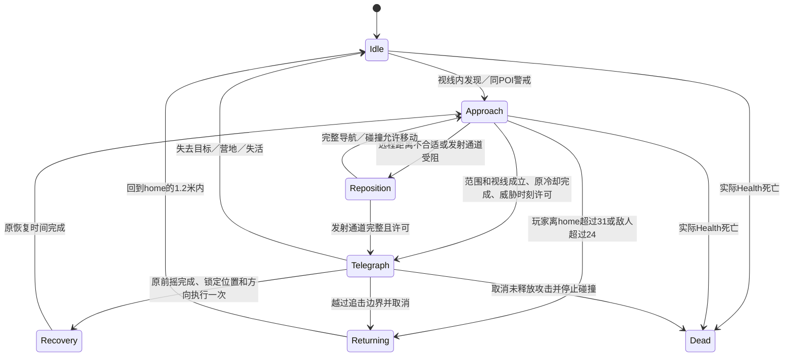
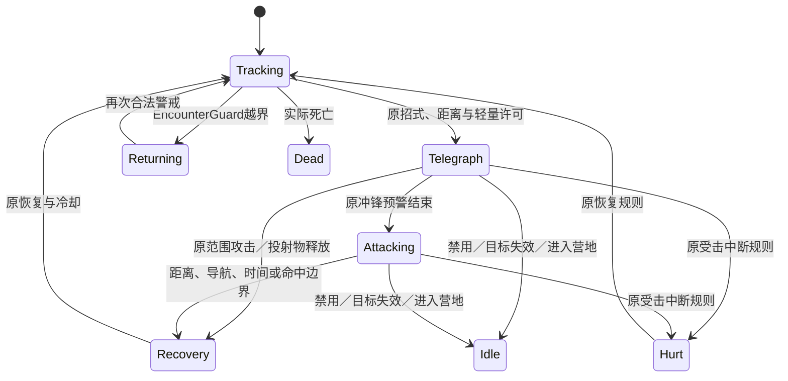

# 实际状态与本批边界

森林Boss还保留Tracking、Hurt、Attacking和独立招式序列。冲锋Attacking持续时间/距离沿用原值；普通攻击没有新增冲锋。森林Boss取消待发意图不推进招式序列；重启组件不得释放已隐藏的旧预警。死亡、营地和返回区取消；暂停保留相对剩余时间，恢复继续预警，而非把旧绝对时刻当成到期。

许可只延迟准备，不提高攻击频率、不退款冷却、不缩短预警、不降低伤害。它复用同场景同目标的现有live-actor集合，按预定威胁时刻比较原0.24秒间距；投射物估算使用真实半径到目标Collider的扫掠距离。不是全局无敌帧或伤害节流器；扇形独立弹、玩家主动移动到不同攻击等仍可能连续命中。

远程阻挡检查：发射锚点→真实前移枪口→锁定瞄准点，半径与现有弹体一致；准备和释放两次核查。遇阻时沿侧向尝试可通行位置；带guard使用现有NavMesh完整路径，不带guard的测试场景仍由CharacterController实体碰撞约束。没有新增穿墙权限、地图障碍或瞬移。

当前不存在：环形包围规划、多目标选择、动态难度、复杂战术指挥器。多敌的物理站位和通路仍由原导航与角色碰撞决定，不将轻量错峰描述为这些能力。

独立生命周期：已释放弹体不依赖当前前摇，但仍由原目标/owner存活、场景归属和6秒寿命规则清理；暂停冻结移动/命中/寿命。唯一掉落与经验仍由CombatEnemy.DropLootOnce及既有来源账/结算处理，AI许可不发放任何奖励。
