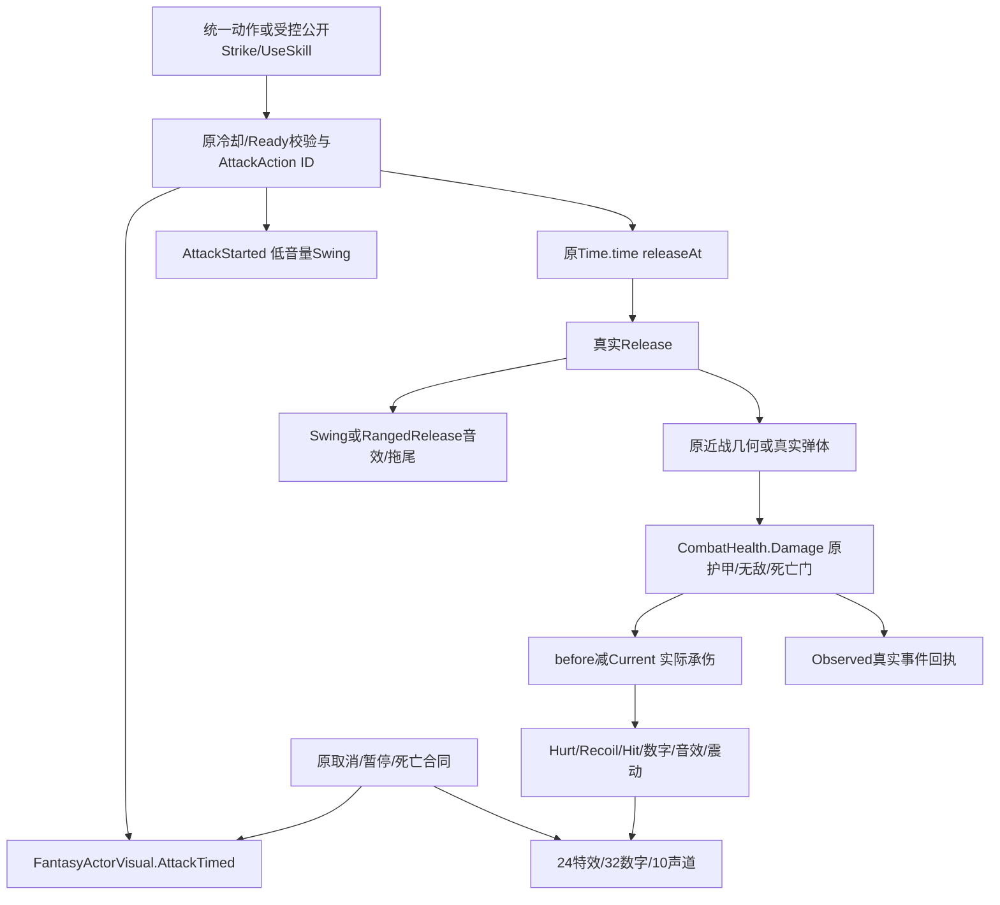

# GAMEPLAY-UX02：表现审计、真实事件与限定修复设计

制定ab6b350ba900894f74efe29a803631271ed6ce7a，实际开工5ecaced7a0886d34698632ff36bc44ed41e71e7f，仅任务/计划差异。用户五文件单独SHA保护，独立测试根GU02-1030-B。首次准备A目录冲突保留，不覆盖。

## 武器/角色/资源

| 对象 | 实际链与资源 | 边界 |
|---|---|---|
| 剑普攻/技能 | 水平斩clip，原动作时长；Release调用Swing；技能业务仍旋风/品质分支 | 不改范围/释放比例/冷却 |
| 长枪普攻/技能 | Stab clip，Thrust线；原追加段/品质逻辑 | 追加伤害段不冒称重复命中 |
| 法杖普攻/技能 | Spellcast_Shoot；真实弹体/爆炸与Cast | 数字来自实际Damage而非爆炸特效 |
| 弓普攻/技能 | 2H_Ranged_Shoot；真实独立箭与Cast | 共享施法声音，不宣称专属高品质录音 |
| 普通/远程/精英 | 既有KayKit骨骼载体+猫族刚性部件，EnemyAttackSignal只画线 | 不是新增猫族完整蒙皮动画 |
| 古林/湖心Boss | 六招冻结定义、BossWarningGeometry共享形状、ForestBossTelegraph独占mesh/material | Fan为真实射线/弹体，不是瞬时地面伤害 |
| 普通BossBrain | 旧三招圆/冲锋带/七射线，锁定origin/direction；StopAttack隐藏 | 旧波次Boss不等于森林Boss |

静态54项资源/46调用点记录在resource-call-inventory.json。实际动画为Assets/FantasyArt/Characters下legacy Animation clips；FantasyActorVisual禁用自动播放器，用SampleAnimation按实际时钟采样。Dodge为程序化旋转，不伪称翻滚骨骼clip。当前没有已接入可靠命中动画事件，释放仍使用既有可配置比例；本批不改。CatActorVisual随骨骼挂点，不决定伤害。KayKit/Kenney既有许可见Assets/FantasyArt/Licenses；没有引入新第三方资源。

CombatSoundBank在Awake合成7个单声道44100Hz AudioClip，独立System.Random；不虚构wav资源或听感评测。AudioSource池10、spatialBlend .65、距离4～35、Linear、doppler0；单cue .035秒防叠加，满池轮转抢占。共享Resources/CombatFeedback/Glow优先，否则既有Shader fallback；生成clips与自建Material由反馈Owner销毁，共享资源不销毁。特效子对象随场景，单命中特效独立seed。暂停冻结age/伤害数字/时钟/震动并暂停声音，Reset/Disable清理；原生音频设备声学效果NOT_RUN。

## 待复现/最小范围

1. 整数伤害文案可能把真实小数致死承伤显示为0：用真实连续Damage留下0.25，再以真实Damage致死，比较实际观察与数字。不修改maxHP/Current/防御，不能用特效调用冒充命中。
2. CombatFeedback.enabled=false后Find仍可返回组件，Paused未检查isActiveAndEnabled；实际Damage可能重建已清理的数字/池特效，AddProjectileTrail也未阻断禁用。用同场景实际Damage及独立拖尾夹具验证；若确认，仅加表现可用门，不改变Damage决策。

没有负例不修改武器时序、Boss几何、AI、地图、随机流、经济或v9。未完成的人工可读性/舒适度/趣味/最终打击感保留NOT_RUN，历史UNKNOWN/C15/Search/青色帧等根因保留UNRESOLVED。

## 已确认修复与分层证据

产品仅CombatFeedback三行：Paused加入isActiveAndEnabled；伤害标签保留两位小数，真实正承伤不足0.01显示<0.01而非0；AddProjectileTrail遵守相同表现可用门。Before7同输入111PASS/4FAIL→After2 115PASS/0FAIL，4项属于2类根因。后续扩展119项增加未命中/实体遮挡反例；单独MissingGlow实际移出隔离副本的资源材质、验证既有Shader fallback和自建材质销毁，随后原SHA恢复，不改主工程资源。

任务§6剩余边界：静态调用链与自动化时序不能证明声学质感/真人预警识别；纯发行构建不能冒充原生操作。普通Boss三招几何/生命周期进行了源码核对，森林六招进行了共享数据/实际Show/Hide及Damage和死亡表现验证；不宣称本批完成正常AI双Boss讨伐、所有物理攻击组合或全场景重建压力测试。缺失Shader/全部音频设备/所有缺资源组合没有有效样本时保持NOT_RUN，不用0代替。
