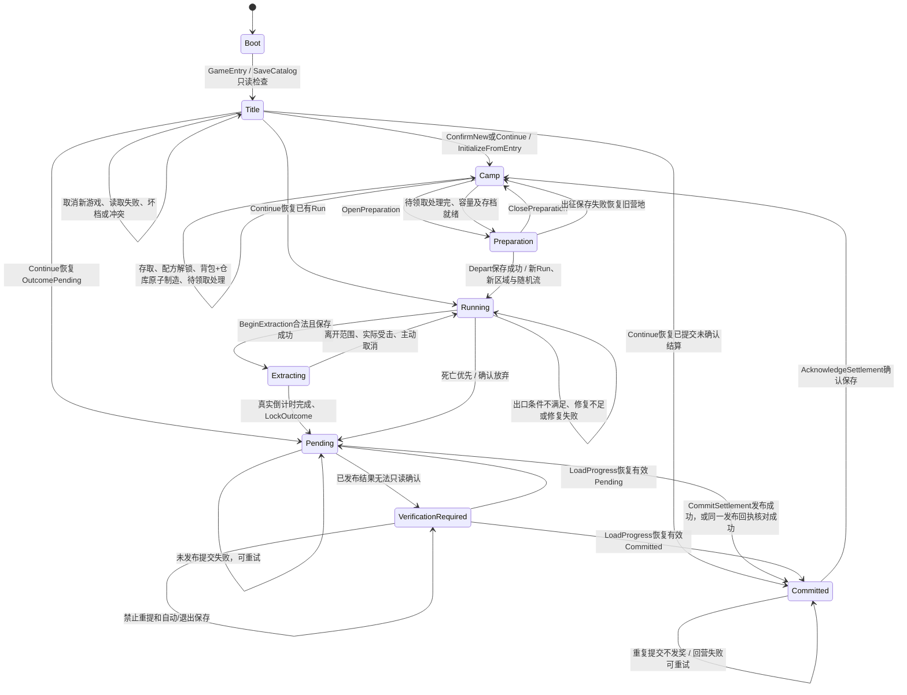

# RUNLOOP-01 真实状态图与边界审计

以 main 4ae4ca8fa8d8d7ff64aaee388bfc653eb58f76e7 为开工代码。以下均为已有实现；不是新增系统。源码路径均在 Assets/CombatPrototype。

VerificationRequired 是本轮修复使用的临时运行时防护，不增加 v9 状态或字段；成功完整读取／新档／旧版迁移后清除。持久化状态仍只有既有Running/Extracting/OutcomePending、Pending/Committed及acknowledged。

| 状态 | 目标、行动及进入/退出条件 | 业务入口与物资边界 | UI与退出/恢复 | 已有实现及验证 |
|---|---|---|---|---|
| Boot/Title | 检查真实单自动档；继续、读取、新游戏确认/取消、设置 | GameEntry、SaveCatalog、NewProfileTransaction；菜单查询不创建Run或领取物资 | 缺失/损坏/不兼容/不确定/冲突分别显示；继续有效档才启动 | 已有实现；Entry、B09Rules链；原生/发行交互另记NOT_RUN |
| Camp | 仓库与随身准备；待领取处理 | CampRuntime、Profile.camp；永久仓库与随身是不同集合 | 营地设施与材料数量，事务保存；读取营地快照 | 已有实现；cycle committed、正常AI |
| Preparation | 装备/双武器/容器/素材堆栈检查 | DepartureReason；pending未清、overflow、存档未就绪阻止出征 | 清单、失败保护规则、费用与真实拒绝原因 | 已有实现，不增加负重或新门槛 |
| Running | 森林探索、战斗、采集、拾取、制造目标查询 | ActiveRun/entryGear、broughtRemaining/earnedRemaining；装备来源标签；地面对象不归属背包 | HUD生命/目标/补给，路线按需；正常退出只是检查点，不是撤离 | 已有实现；cycle run、normalAI、恢复 |
| Ground | 收集资源或敌人死亡只生成地面物 | AdventureResource.Hit、CombatEnemy.DropLootOnce、LootPickup；只有PickUp/Add成功才计入随身及来源账 | 拾取范围/遮挡/容量检查，未成功仍留地面；分页恢复 | 已有实现；两节点一拾一留、运行/结算来源矩阵 |
| 出口不可用/可用 | 免费出口无需清场；渡口木2石1，随身材料不足不扣 | InteractionResolver共享展示/执行目标；RepairReason、RepairExit原子扣费/回执 | 当前动作、持有/需求、拒绝原因；已修不重复收费 | 已有实现；不足材料提示对照、正常AI真实修复 |
| Extracting | 范围内真实倒计时；可取消、受击/出界中断 | BeginExtraction保存成功才生效；消耗账不因取消退款 | 实际剩余秒数及取消键；保存失败回Running | 已有实现；cycle running |
| Pending | 结局锁定，不再领取或战斗；提交前不算永久收益 | LockOutcome、AdventureRules.Plan；plan仅预览，地面未拾取排除；死亡/放弃丢新物资，入场保护保留 | 待确认/结局未保存/重试；退出恢复Pending，不重新抽奖 | 已有实现；跨进程Pending、death、fault |
| Committed | 唯一plan已发布，仓库/待领取持久化 | committedRuns与settlementId；重复Commit早返回，不重复发奖 | 已保存，回营失败重试；恢复Committed而非再次发奖 | 已有实现；本轮修复发布后false的内存/磁盘不一致 |
| 结果待核对 | 不能证明已提交或未提交，禁止盲目重写 | SettlementNeedsRead只在运行时；SaveProgress捕获门禁；不创造经济状态 | 结果待核对标题与完整读取入口；读取失败继续保护 | 本轮最小修复；Missing/Corrupt专项 |
| ack / pending奖励 | 确认回营；满仓收益保留待领取；未处理完不能出征 | AcknowledgeSettlement、ClaimPending、DiscardPending原事务 | 领取仓库/背包、明确确认丢弃；ack保存失败保留重试 | 已有实现，不重做；正常链测试；ack发布后故障专项NOT_RUN |
| Manufacture | 解锁前置/材料/空间校验，营地随身优先、仓库补足 | CampWorkbenchRuntime.PayMaterials、CampRuntime.Commit；失败快照回滚，发布后核对 | 左右工作台、真实材料缺口及成功/失败通知 | 已有UX02能力；本轮cycle精确支付/回滚及制造后再次出征 |
| 下一Run | 同Profile、新Run和区域，保留永久仓库/配方/徽章/教程 | Depart；新种子才生成新布局，已存Run恢复不重抽 | 正常森林入口，旧在途继续自身版本 | 已有实现；Final新进程核对与normalAI三阶段 |

## 风险收益审计（不调经济）

- 生命/翻滚/药水与战斗风险已存在；药水消耗来源账、冷却和背包配置影响续航。没有饥饿、耐力、天气或陷阱系统，不编造风险。
- 五地点收益倾向、剩余节点/宝箱/地面组、存活敌人与精英路径风险、真实NavMesh距离和免费/已修/待修出口均来自现有RouteScoring；评分是首版建议，不是保证收益、ETA或自动移动。
- 继续探索可取得尚未消耗的资源/宝箱/敌人奖励，也承担生命损失及死亡丢失新物资；永久徽章与首次回执遵守B07独立规则，不把徽章当作可撤离材料。
- 素材/药水以堆栈限额影响携带，装备受胸挂/背包网格与品质属性约束；当前没有统一重量、耐久损耗和货币估价机制，不能写成已有。
- 当前无统一货币价值，审计只比较实际材料/装备数量和消耗。地面、随身RunLoot、Pending计划、已提交仓库、待领取分别统计。
- 风险信息在路线/装备/背包/结果页面分布，源码上可查不等于新手已理解；人工可理解性及原生键鼠继续NOT_RUN。没有用本轮审计授权新地图、经济系统或大型任务框架。

## 唯一确认断点

原CommitSettlement把SaveProgress(false)都当作未发布，故障证据Before显示disk rev4/Committed、live rev3/Pending并误称物资未转移。最小修复比对同一修订、Profile、完整结算回执：确已发布则确认；确为旧Pending才允许重试；缺失/坏档/不一致则只读恢复，冻结自动/退出保存。奖励计划、来源账、概率、随机流与v9结构未改。其余未经复现的猜想不顺带改造。
