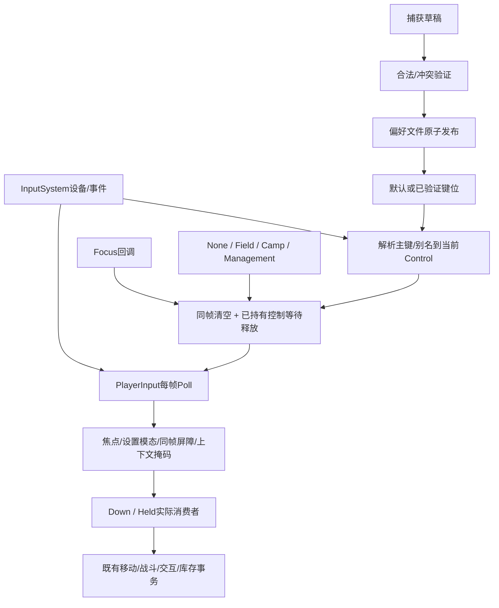

# UX-TECH-01：状态、消费者与限定设计

制定基线bee8c58db551e27739151723849410100528029b。开工远端0ab582423c031528d824879a0026e9158f287bfe仅增加本TASK和计划，已正常快进；产品与bee一致。用户Scene/Settings/Recovery另记原SHA，主工程不覆盖。

## 实际状态机

PlayerInput采样帧缓存只读，不消耗边沿；每个消费者仍有业务安全门。Field允许战斗，Camp允许移动/设施并保持战斗暂停，Management允许面板动作/旋转/药水等定义，但实际Potion/Exit还由对应业务门校验。Loading、存档模态、选择升级、结果、准备和放弃确认使上下文None。死亡应优先于Management。

InputSettingsPanel是原始控制捕获器，不使用Down/Held；需要自己的焦点/设备重臂。GamePreferences是独立v1偏好文件，不在v9进度封装中。主键/别名冲突以Definition的上下文交集判定，R的World放弃与Management旋转是合法复用。Esc、右键、F2/F3/F5/F9、1/2/3和N是明确保留入口，不伪装成可重绑定动作。

## 实际消费者

| 消费者 | 输入与合同 |
|---|---|
| ThirdPersonHero | 四向Held、Sprint Held、Dodge Down、Attack Down；战斗/移动有Health、暂停、CampWalking门 |
| AdventureCombat | Skill/Switch Down；Ready、OpeningMenu、焦点、UI屏障、翻滚/冷却与Flow门；不修改其时序/数值 |
| PlayerInventory | Tab/B/C/Potion；实际SetOpen负责暂停/鼠标/屏障，Esc为固定返回 |
| CatInventoryPresenter / ContainerInventoryView | Rotate统一动作；鼠标拖放/右键取消为指针语义；库存改变走原业务事务 |
| InteractionResolver | E/H统一动作、共享显示token、同帧一次、执行前复核，禁用/死亡/暂停/结果守卫 |
| AdventureFlow / CampRuntime | H准备/回营，Field出口由Resolver；Camp设施经原事务/保存门 |
| CombatSession | R统一动作，N固定波次入口；森林取消波次，结果/保存状态另有门 |
| PlayerHudPresenter | Help/Route，Revision刷新键帽/帮助；F2 UI缩放、F3 Editor/开发诊断、Esc返回固定 |
| CombatSaveSystem | 固定F5、Editor可选F9、确认框Esc；定位/原子保存/恢复/防重复合同不改 |
| HeroProgression | 固定1/2/3升级选择，选择态及ClosedFrame；原收益/RNG不改 |
| OrbitCamera | 固定Esc释放、右键捕获、鼠标delta；面板/关闭帧/焦点回调、暂停震动门 |
| InputSettingsPanel / TitleMenu | 原始键/鼠捕获、uGUI点击、设置保存；草稿先验证后发布再应用 |
| HUD、旧OnGUI、教程、配方/出口说明 | PlayerInput.Key/Cap/Movement/Pair/HelpText实时文案；保留键说明按实际保留合同 |

完整自动扫描清单在consumer-inventory.json（含行号/分类），不把未使用Keyboard/Mouse局部变量当成真实绕行。没有证据就不重写相机/所有UI/保留快捷键。

## 已复现缺陷与最小方案

Before实际9PASS/9FAIL（18断言）：

1. Context先判断Inventory/HUD再判断Health.Dead：死亡至结果锁定之间管理动作仍可读。把死亡门移到Management之前，不改死亡/结算逻辑。
2. Cursor未锁且EventSystem缺失时射线命中列表为空，被解释为可用世界鼠标动作；实际Skill消费者消耗了冷却。缺失UI路由时对未锁定的世界鼠标动作保守阻断；Management独立鼠标旋转语义保留，锁定瞄准不依赖UI路由。
3. 设置捕获绕过PlayerInput焦点/设备屏障：失焦或替换键盘时收下已持有的键。失焦暂停捕获并重新等待释放；用输入设备epoch及当前设备身份变化重臂，不直接取消用户草稿，不更改定义/别名/冲突规则。
4. GamePreferences只在临时写入前比较loadedHash，BeforePublish期间的外部改写仍被Replace覆盖。发布前再次使用原乐观并发条件复查；冲突不发布、不应用，保留外部文件，要求重新打开后明确重试。保留原文件格式/备份/原子写入方式。

不修改战斗数值/AI/武器/护甲/经验、经济、掉落、地图、RNG、结算或v9/迁移。拟定修改只在PlayerInput、InputSettingsPanel、GamePreferences，若后续证据要求扩域则另列，不借审计重建框架。

## 缺口分类

- 已实现：19动作定义/上下文冲突、每帧缓存、默认/别名、草稿、屏障、实际消费者、v1偏好和v9分离；本轮需重新执行证据。
- 已确认：上述四类根因（焦点与设备捕获共享重臂问题），不是单凭源码猜测。
- 需要补证：默认/别名全矩阵、所有主要UI开关、实际指针/UI命中、正常保存/失败/恢复、非开发验收Player和新进程偏好恢复。
- 环境/人工：OS原生焦点、真实设备拔插、物理键鼠、人工理解/舒适度/趣味仍NOT_RUN。模拟Focus回调、虚拟设备和uGUI事件不能改称原生。
- 历史：UNKNOWN、青色帧、Search/C15等根因继续UNRESOLVED，不重复关闭实验。

## UI/时间与业务边界

- Inventory.SetOpen、HUD.SetDetails、输入设置Open/Close保存并恢复Time.timeScale和Cursor；关闭帧设置Barrier。Progression另有ClosedFrame；SaveMenu/Result/Preparing阻止玩法动作。Camp不是Field：允许营地走动，战斗由Flow.BlockCombat限制。
- EnemyProjectile.Update/Advance检查Target.GameplayPaused与Time.timeScale<=0，移动、寿命、判定在门后；AdventureProjectile同样受暂停限制。AdventureCombat使用Time.time冷却，输入调用仍经过Ready/UI门。不会因打开菜单退款冷却；未释放动作沿COMBAT取消规则。
- 鼠标拖放/点击/相机delta是指针输入，不应伪装成可重绑定动作。右键捕获/取消、Esc返回、数字升级键和F5等为既有保留合同。当前没有理由整体改成新输入框架。
- 保存错误、Unknown、结果待确认由SaveSystem/Flow/唯一提交门负责；本轮未改变这些业务合同。偏好保存失败只影响独立设置文件，不创建Run，不发布库存或奖励。
- 收集到的Source/Rules/虚拟uGUI/Editor正常AI/非开发验收Player分层记录；任何一层缺口不由另一层替代。完整OS失焦、硬件拔插、所有模态交叉组合及真人可读性没有自动获得PASS。

## 修复边界

第二次偏好哈希检查覆盖已证实的“临时文件写入后、发布钩子期间外部变化”，并不是跨进程OS级 compare-and-swap 文件锁。最终检查到File.Replace间仍存在很窄的非合作写入竞态；没有证据时不扩建全新锁协议。设备epoch为瞬态捕获重臂标记，不写入v9或偏好文件。全局DeviceChange原有Rebuild行为保留。
