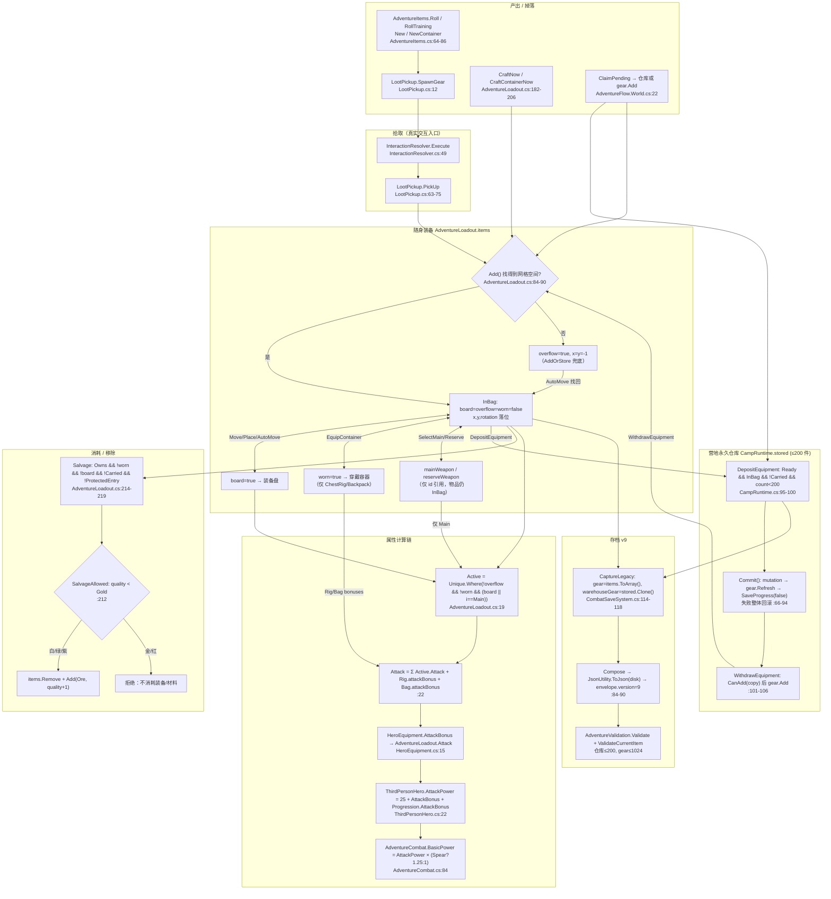

# UX-04-B2 · A：当前库存系统审计与真实数据流

> 本轮只读。所有结论基于源码逐行核验，不依据 UI 外观推断数据行为。
> 标记：**[S]** 源码事实（含 file:line）· **[E]** Player 证据 · **[C]** 计算结果 · **[D]** 设计推论 · **[H]** 未验证假设

## 0. 审计范围与基线

| 项 | 值 | 标记 |
|---|---|---|
| 基线 Commit | `95caf234256613d4a6e4f89a8ab0dc09c397c6b2` | [S] `git rev-parse HEAD` |
| 分支 | `feature/ux-progression-04` | [S] |
| 受跟踪工作树 | 空（0 改动） | [S] `git status --porcelain=v2 --untracked-files=no` |
| B1 状态 | 已提交并推送，本轮不修改 | [S] |
| 审计对象 | Inventory / EquipmentGrid / ContainerInventoryView / CatInventoryPresenter / AdventureLoadout / EquipmentItem / GearItem / 拾取 / 穿戴 / 卸下 / 存储 / 取回 / 分解 | [D] 范围解释 |

**命名澄清 [S]**：仓库中**不存在**名为 `EquipmentGrid` 或 `EquipmentItem` 的类型。全项目 `*.cs` 中唯一的装备数据类是 `GearItem`（`Assets/CombatPrototype/AdventureItems.cs:7`）；"装备盘 / 胸挂" 对应 `GearItem.board` 布尔位与 `ContainerDefinition` 网格（`ContainerDefinition.cs:4`），"装备槽" 对应 `AdventureLoadout.mainWeapon` / `reserveWeapon` 两个字符串 id（`AdventureLoadout.cs:12`）。`HeroEquipment` 是旧版剑/甲阶数的兼容壳（`HeroEquipment.cs:5`），在新装备系统下 `AttackBonus` 直接转发 `AdventureLoadout.Attack`（`HeroEquipment.cs:15`）。[S] 故本审计以 `GearItem` + `AdventureLoadout` + `ContainerDefinition` 三者的真实结构为准。

---

## 1. 数据结构（源码事实，非 UI 推断）

### 1.1 GearItem 持久化字段（19 个 public 字段，全部被存档序列化）

`Assets/CombatPrototype/AdventureItems.cs:7-21` [S]

| 字段 | 类型 | 含义 | 来源行 |
|---|---|---|---|
| `origin` | `ItemOrigin` | 来源类别 | `:9` |
| `originRunId` | `string` | 来源局 id | `:10` |
| `id` | `string` | **全局唯一身份** | `:11` |
| `affixes` | `int[]` | 词缀（武器 ≤2） | `:12` |
| `type` | `GearType` | 武器/装备类型 | `:13` |
| `quality` | `GearQuality` | 白/绿/紫/金/红 | `:14` |
| `x, y` | `int` | 网格坐标（默认 -1） | `:15` |
| `board` | `bool` | 是否在装备盘（胸挂网格） | `:16` |
| `legacyTier` | `int` | 旧档阶数 | `:17` |
| `definitionId` | `string` | 定义模板 id | `:18` |
| `dataRevision, rotation, widthOverride, heightOverride` | `int` | 版本/旋转/旧型占格 | `:19` |
| `overflow, worn` | `bool` | 迁移暂存 / 已穿戴容器 | `:20` |
| `savedAttack, savedDefense` | `float` | 冻结后的攻击/防御 | `:21` |

`[Serializable]` 整类被 `JsonUtility` 序列化，**无字段白名单**（`CombatSaveSystem.cs:88`），因此上述 19 字段全部落盘。[S]

### 1.2 计算属性（不落盘，运行时派生）

| 属性 | 定义 | 行 | 标记 |
|---|---|---|---|
| `Container` | `type == ChestRig || Backpack` | `:23` | [S] |
| `InBag` | `!board && !overflow && !worn` | `:24` | [S] |
| `Weapon` | `NewWeaponRegistry.Weapon(type)` = `(int)type<4 || Is(type)` | `:26` + `NewWeaponRegistry.cs:7` | [S] |
| `Power` | 品质基准 `{8,19,43,78,132}`，取自 `QualityData/*.asset` | `:30` + 5 个 asset `power:` 行 | [S] |
| `Attack` | `dataRevision>0 ? savedAttack : LegacyAttack` | `:34` | [S] |
| `Defense` | `dataRevision>0 ? savedDefense : LegacyDefense` | `:35` | [S] |
| `Size` | `SizeAt(rotation)`，可旋转 | `:27-29` | [S] |
| `Cells(turn)` | 占格枚举（含 `Definition.occupiedCells` 非矩形形状） | `:37-42` | [S] |
| `Name` | 品质前缀 + 特殊奖励标签 / 定义显示名 / 类型名 | `:25` | [S] |

`FreezeNewStats()`：新装备 `savedAttack = Container ? 0 : Power * Definition.attackFactor`（`:52`）。`UpgradeLegacy()`：旧装备把 `LegacyAttack/LegacyDefense` 冻结进 `savedAttack/savedDefense` 并置 `dataRevision=1`（`:45-51`）。[S]

### 1.3 类型枚举

- `GearType { Sword, Spear, Staff, Bow, Armor, Trousers, Arms, Boots, Accessory, ChestRig, Backpack, TwinBlades=11, Greatsword=12, Scythe=13 }`（`AdventureItems.cs:5`）。`NewWeaponRegistry.Valid` 允许 `0..10` 与 `11..13`（`NewWeaponRegistry.cs:5-7`）。[S]
- `GearQuality { White, Green, Purple, Gold, Red }` = `0..4`（`:6`）。[S]
- 品质占格 `Sizes = {1×1, 1×2, 2×2, 2×3, 3×3}`（`:57`）。[S]
- `ItemOrigin { Unspecified, DeploymentProtected, RunLoot, LegacyProtected }`（`AdventureState.cs:22`）。[S]

---

## 2. 容器、容量、Overflow、Main、Worn、Board

| 概念 | 真实定义 | 标记 |
|---|---|---|
| **随身装备列表** | `AdventureLoadout.items : List<GearItem>`，无代码层硬性数量上限；存档校验 `gear.Length<=1024`（`CombatSaveSystem.cs:326`） | [S] |
| **永久仓库** | `CampRuntime.stored : List<GearItem>`，上限 `Capacity=200`（`CampRuntime.cs:11-12`）按**件数**计，非格数 | [S] |
| **背包网格** | 由当前**穿戴的** Backpack 定义决定：`ContainerFor(items,false)` → `worn && type==Backpack` 的 `definitionId`，否则 `bag_standard`（`AdventureLoadout.cs:31-36`） | [S] |
| **装备盘网格** | 同上取 `ChestRig`（`rig_standard`） | [S] |
| **格数** | `ContainerDefinition.Capacity => width*height - blockedCells.Length`（`ContainerDefinition.cs:20`） | [S] |
| **Main** | `items.Find(i => i.id==mainWeapon && i.InBag && i.Weapon)`（`AdventureLoadout.cs:16`） | [S] |
| **Reserve** | `items.Find(i => i.id==reserveWeapon && i.InBag && i.Weapon)`（`:13`） | [S] |
| **Carried** | `i.id==mainWeapon || i.id==reserveWeapon`（`:14`） | [S] |
| **Worn** | `i.worn`；仅容器可 `worn`，校验 `!item.worn || item.Container`（`CombatSaveSystem.cs:318`）；`EnsureContainers()` 保证恰好 1 胸挂 + 1 背包穿戴（`:45-52`；`CombatSaveSystem.cs:329`） | [S] |
| **Board** | `i.board`：物品位于胸挂网格内，`CanPlace` 禁止容器与主武器入盘（`:98-99`） | [S] |
| **Overflow** | `AddOrStore()` 在 `Add()` 找不到空间时把物品置 `overflow=true; x=y=-1; board=worn=false` 并**保留在 items 中**（`:91`）；不计属性（`:19` `Active` 排除 `overflow`） | [S] |
| **装备身份** | `id` 为 `Guid.NewGuid().ToString("N")`（`:64`）或新武器哈希 32 位（`NewWeaponRegistry.cs:14`）；`Owns()` 要求 `items.Count(i=>i.id==item.id)==1`（`:53`）；存档要求全局 id 唯一（`CombatSaveSystem.cs:328`） | [S] |
| **装备属性** | `Attack/Defense` 冻结在 `savedAttack/savedDefense`；`Clone()` 保留全部字段并深拷贝 `affixes`（`:44`） | [S] |

### 2.1 各容器定义（源码 asset 事实）

`Assets/CombatPrototype/Resources/ContainerData/*.asset` [S]

| id | 宽×高 | 可用格 `Capacity` | attackBonus | defenseBonus | moveBonus | harvestBonus |
|---|---|---|---|---|---|---|
| `rig_standard` | 8×6 | 48 | 0 | 0 | 0 | 0 |
| `rig_light` | 6×5 | 26 | 0 | 0 | +0.1 | 0 |
| `rig_heavy` | 9×6 | 50 | 0 | 3 | −0.05 | 0 |
| `bag_standard` | 12×8 | 96 | 0 | 0 | 0 | 0 |
| `bag_gather` | 10×8 | 76 | 0 | 0 | 0 | 1 |
| `bag_relic` | 8×6 | 44 | **+6** | 0 | 0 | 0 |

`Capacity` 由 `width*height - blockedCells.Length` 计算 [C]。`bag_relic.attackBonus=6` 是**容器级**攻击加成，不来自任何单件装备 [S]。

### 2.2 状态互斥与可迁移性

- `InBag` 严格定义为 `!board && !overflow && !worn`，与品质、类型无关（`:24`）。[S]
- `Fit()` 只按 `Cells()` 与 `ContainerDefinition.Allows()` 判断，**不检查品质**（`AdventureLoadout.cs:54-63`）。[S]
- `DepositEquipment` 不检查品质（`CampRuntime.cs:95-100`），`WithdrawEquipment` 仅检查 `gear.CanAdd(copy)`（`:101-106`）。[S]
- B1 真实 Player 证据：金/红装备在按钮禁用分解后仍成功入库并取回（`PLAYER_RUN_MATRIX.csv` F6/F7；`EVIDENCE/INDEX.json` 2 运行 / 2 PASS）。[E]
- 结论：金/红装备可正常入库/取回/读档，属性经 `Clone()` 完整保留；B1 门禁只作用于 `Salvage`（`AdventureLoadout.cs:212-219`）。[S][E]
- 所有暂存态（`overflow` / `board` / `worn` / `Carried`）均存在产品侧解锁路径：`AutoMove()`（`:121-125`）、`Place()`（`:111-118`）、`SelectMain/SelectReserve/ClearReserve/SwapWeapons`（`:126-139`）、`DepositEquipment/WithdrawEquipment`（`CampRuntime.cs:95-106`）。[S]

---

## 3. 真实数据流图

**图中每条边均为源码调用关系 [S]**（行号见框内）。特别注意：**Reserve 不进入 `Active`**（`i==Main` 是唯一非 board 的入选条件），故备用武器对 `Attack` 贡献恒为 0 [S]；`WeaponLoadoutView.cs:10` 的 UI 文案「只有手持词缀生效」与此一致 [S]。

---

## 4. 全链路逐环节核验（拾取 → 穿戴 → 卸下 → 存储 → 取回 → 分解）

| # | 环节 | 权威入口 | 前置条件 / 数据行为 | 标记 |
|---|---|---|---|---|
| 1 | 装备拾取 | `LootPickup.PickUp`（`LootPickup.cs:63`）经 `InteractionResolver.cs:49` 由 `E` 触发 | `CanPickUp`；`Gear != null` 时调用 `AdventureLoadout.Add(Gear)`，失败提示「背包空间不足，请整理或分解装备后再拾取」并**不消耗掉落物** | [S] |
| 2 | 放入背包 | `AdventureLoadout.Add`（`:84-90`） | 拒绝重复 id；`dataRevision==0` 先 `UpgradeLegacy`；`Find` 在 Bag 网格找位；打 `origin=RunLoot`（若 `flow.Tracking`） | [S] |
| 3 | 溢出暂存 | `AddOrStore`（`:91`） | `Add` 失败 → `overflow=true, x=y=-1` 保留；`Overflow` 页 / `AutoMove` 找回 | [S] |
| 4 | 穿戴（装备盘） | `Move→Place`（`:111-119`）/ `AutoMove`（`:121`） | `CanPlace` 校验 `Owns`、`!worn`、旋转允许、容器不可入盘、主武器不可入盘、网格 `Fit`、单件交换兼容 | [S] |
| 5 | 穿戴（主/备武器） | `SelectMain`/`SelectReserve`（`:126-127`） | 要求 `Owns && Weapon && InBag`；`SelectMain` 若目标已是备用则把旧主武器转备用；触发 `EquipmentChanged()` + `Refresh()` | [S] |
| 6 | 穿戴（容器） | `EquipContainer`（`:161-169`）/ `PreviewContainer` | 双容器空间完整预览，旧容器收回背包，不丢物 | [S] |
| 7 | 卸下 | `AutoMove`（board→bag）/ `ClearReserve`（`:137`）/ `SwapWeapons`（`:138`） | 均为状态位变更 + `Refresh()`；不删除物品 | [S] |
| 8 | 存入永久仓库 | `CampRuntime.DepositEquipment`（`:95-100`） | `Ready && item.InBag && !Carried && stored.Count<Capacity && !duplicate`；`Clone()` 后清 `x/y/board/worn/overflow` | [S] |
| 9 | 取回 | `CampRuntime.WithdrawEquipment`（`:101-106`） | `Ready && gear.CanAdd(copy)`；失败提示「背包空间不足，装备仍保留在永久仓库」；成功后 `stored.Remove` | [S] |
| 10 | 原子提交 | `CampRuntime.Commit`（`:66-94`） | `mutation → gear.Refresh → SaveProgress(false)`；保存失败回滚 gear / 仓库 / 材料 / 药水 / 档案 | [S] |
| 11 | 分解 | `AdventureLoadout.Salvage`（`:214-219`） | 依次：`Owns && !worn && !board && !Carried && !ProtectedEntry` → `SalvageAllowed(quality<Gold)` → 铁矿堆栈容量 → `items.Remove` + `Add(Ore, quality+1)` | [S] |
| 12 | 分解拒绝（B1） | `SalvageAllowed`（`:212`） | 金/红在第 2 道门被拒，**早于任何 `items.Remove` 或材料变更** | [S][E] |

分解入口共 **2 处**，均汇入同一 `Salvage`：`ContainerInventoryView.cs:137`（IMGUI）、`CatInventoryPresenter.cs:44`（uGUI 二次确认）[S]。全仓库 `Add(MaterialKind.Ore)` 仅出现在 `Salvage` 内 [S]。

---

## 5. 物品数量与容量（真实上限）

| 层级 | 上限 | 依据 | 标记 |
|---|---|---|---|
| 随身 `items` | 存档校验 `2..1024` 件（`gear.Length>=2 && <=1024`） | `CombatSaveSystem.cs:326` | [S] |
| 永久仓库 `stored` | `200` 件（`stored.Count>=Capacity` 拒存） | `CampRuntime.cs:11,98` | [S] |
| 仓库存档校验 | `p.warehouse.Length<=200` | `AdventureValidation.cs:12` | [S] |
| 背包网格 | 由穿戴容器决定，默认 `bag_standard` 96 格 | `ContainerDefinition.cs:20` + asset | [S] |
| 装备盘网格 | 默认 `rig_standard` 48 格 | 同上 | [S] |
| 单件占格 | 白 1 / 绿 2 / 紫 4 / 金 6 / 红 9 格（矩形基准；可被 `occupiedCells` 覆盖） | `AdventureItems.cs:57` + `Cells()` | [S][C] |
| 材料 | `MaterialLimit=100000000`（1 亿）/ 每种；`SupplyUsed()/SupplyLimit` 另限堆栈格数 | `CampRuntime.cs:11`、`AdventureFlow.Supplies.cs:20-22` | [S] |
| 药水 | ≤99 | `PlayerInventory.cs:34` | [S] |
| 待领取 | `pending.Length<=4096` | `AdventureValidation.cs:12` | [S] |

**推论 [D]**：真正约束「随身可持有多少件」的是**网格形状**（96 格，且高品质单件占 6~9 格），而非 1024 的校验值；仓库 200 是独立的**件数**上限，与网格无关。二者不可混用为同一「容量」概念。

---

## 6. 来源 / 身份 / 属性 / 状态 汇总

| 维度 | 现有数据 | 是否已可向玩家展示 | 标记 |
|---|---|---|---|
| 身份 | `id`（唯一）、`definitionId` | 否（UI 无 id 展示） | [S] |
| 品质 / 类型 / 攻击 / 防御 / 占格 | `quality`, `type`, `Attack`, `Defense`, `Cells()` | 是（IMGUI 详情 `ContainerInventoryView.cs:120-128`；uGUI `CatInventoryPresenter.cs:44`） | [S] |
| 来源类别 | `origin` 4 值 + `originRunId` | **仅 IMGUI** 通过 `AdventureFlow.SourceLabel()` 展示（`:129`）；uGUI 不展示 | [S] |
| 获取**地区** | `RunState.region` 存在于**局**层级（`AdventureState.cs:27`），`GearItem` 上**无**地区字段 | 否 | [S] |
| 装备状态 | `InBag` / `board` / `overflow` / `worn` / `Carried(Main,Reserve)` / `ProtectedEntry` / `SalvageAllowed` | 部分：IMGUI 详情有状态串（`:124`）；uGUI 仅部分 | [S] |
| 收藏 / 锁定标记 | **不存在**（全项目无 `favorite`/`locked`/`收藏`/`锁定` per-item 字段） | 否 | [S] |

`ProfileState.specialRewards` / `RuinsSpecialRewards.CollectionLabel` 是**档案级奖励回执**（`AdventureState.cs:18`、`RuinsSpecialRewards.cs:105`），展示「遗迹藏品」，不是装备上的收藏标记，不可复用为 per-item 收藏 [S]。

---

## 7. 关键结论（供后续章节引用）

1. [S] 业务逻辑**只有一套**：`AdventureLoadout`（随身）+ `CampRuntime`（仓库）+ `AdventureFlow`（局/存档）。IMGUI 与 uGUI 均为**视图**，共用 `ContainerInventoryView` 静态拖拽状态与 `CampInventoryView.Section` 静态状态。因此 B2 不应「再实现一套业务逻辑」，只需新增**纯查询/筛选服务**供两视图共用。
2. [S][E] B1 门禁（`SalvageAllowed`）位于 `Salvage` 内，是所有分解入口的唯一权威点；金/红不可分解后仍可入库/取回/穿戴/读档，属性不丢。B1 真实 Player 读档证据：`AttackPower=33`、10 件装备、金/红 `SalvageAllowed=False`。
3. [S] `AttackPower` 计算链为 `25 + Σ(Active.Attack) + Rig/Bag.attackBonus + Rank(Strength)*5`；`Active` 排除 `overflow`/`worn`，仅纳入 `board` 物品与 `Main`。**Reserve 贡献恒为 0**。
4. [S] `origin`/`originRunId` 已存在且被存档校验强约束（`AdventureValidation.cs:35`：`i.originRunId==run.runId && i.origin==...`），**不得新增来源字段**，也不得改写其语义。
5. [S] 容量：仓库 200 件、随身 ≤1024 件（校验）、网格按穿戴容器。当前 UI 已显示 `永久仓库 {n}/200`（`CatInventoryPresenter.cs:51`）与 `装备 {n}/200 件`（`CampInventoryView.cs:19`），但**仓满时仅按钮置灰**，无专门提示文案。
6. [D] 金/红不可分解后缺少消耗出口，长期会向仓库累积；200 是否足够取决于每局产出速率与留存策略，需实测数据，**本轮不修改容量**。
7. [H] 本轮为只读审计，**未执行任何 Player 运行**；`PLAYER_ACCEPTANCE.md` 为未来实施批次的验收计划，不是本轮结果。
