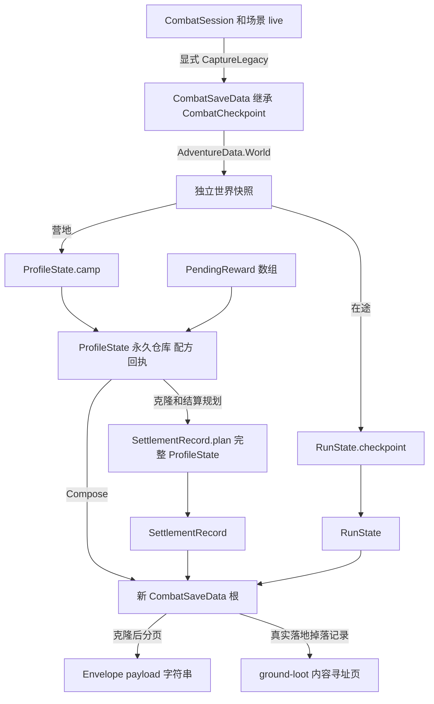
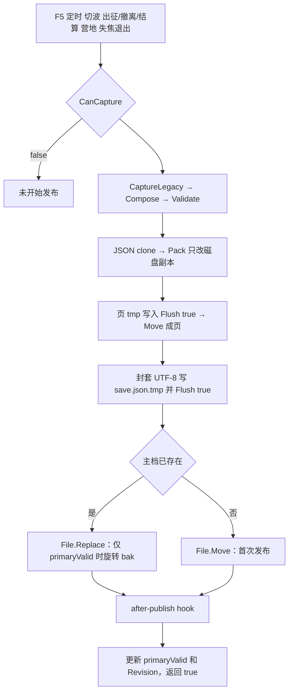
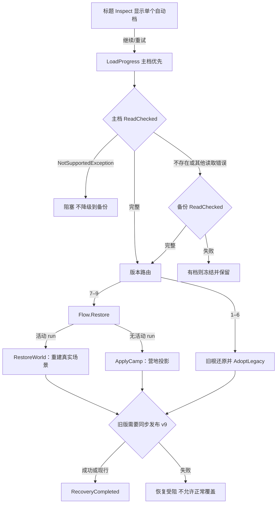
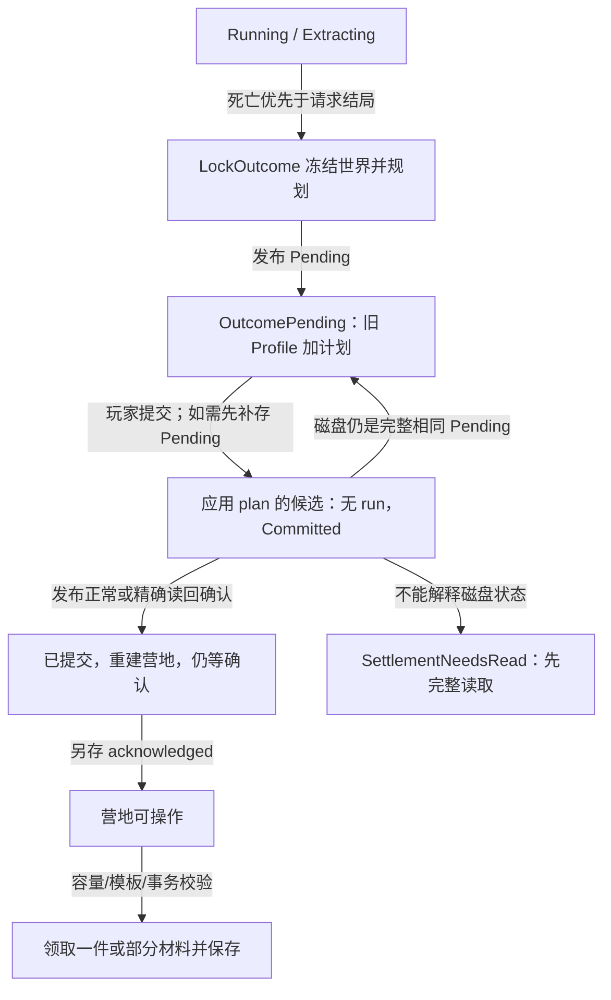
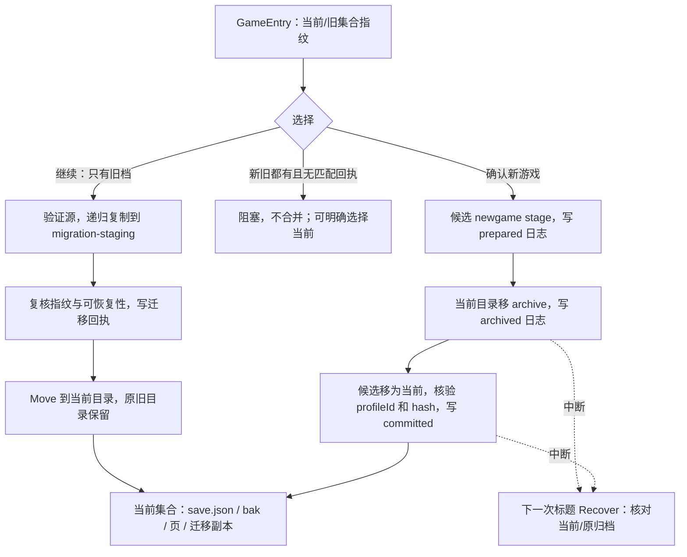

# UX05 预检 · 现有存档架构

**[S]** 源码事实（含文件行号） · **[E]** Player 证据 · **[C]** 静态复算 · **[D]** 设计推论 · **[H]** 未验证假设。基线为此次预检所见的工作树源码；不把历史交付当成当前二进制证明。**[E] 本轮未运行 Player、未读取或写入真实玩家存档，无运行时结论。** 字段逐项见 [SCHEMA_INVENTORY.csv](<SCHEMA_INVENTORY.csv>)；其中「声明初始值」只记录 C# 显式声明，并不承诺老 JSON 缺字段时 Unity 的反序列化结果。

## 图 1 · 序列化边界和权威数据

- [S] `CombatSession` 是运行时组装器，非 DTO：挂接 Flow、Camp、Saves、Waves、Events；`WorldReady` 核实角色、敌人、场景初始化与森林演员匹配。清波先补发尚未结算的掉落，下一波构建后存档；`Restart` 清现场并重建默认状态，不是读档。见 [CombatSession.cs:6–52](<../../../Assets/CombatPrototype/CombatSession.cs#L6-L52>)、[CombatSession.cs:60–127](<../../../Assets/CombatPrototype/CombatSession.cs#L60-L127>)。
- [S] `AdventureData` 是纯快照工具，不是档案或管理器。`Clone<T>` 用 JsonUtility 对泛型 `Box<T>.value` 往返；`World` 按声明类型 `CombatCheckpoint` 取投影，并清空旧用的 `warehouseGear/warehouseMaterials/unlockedRecipes`；普通 v9 的 `Compose` 新建根，只设置 revision、两存在位和三个子对象，不把 live 世界复制到根的继承字段。根仍声明继承字段（包括被分页器处理的字段），不可把「不是权威」误作「字段不可序列化」。见 [AdventureState.cs:69–74](<../../../Assets/CombatPrototype/AdventureState.cs#L69-L74>)、[CombatSaveData.cs:4–41](<../../../Assets/CombatPrototype/CombatSaveData.cs#L4-L41>)、[AdventureFlow.cs:82–99](<../../../Assets/CombatPrototype/AdventureFlow.cs#L82-L99>)。
- [S] 永久态以 `profile` 为权威，装备、材料、配方、待领取、已结算 Run ID、Boss 回执、永久特殊奖励、制造目标和教程都有字段；在途世界以 `activeRun.checkpoint` 为权威；不在途时用 `profile.camp`。`settlement.plan` 也是完整 Profile，包含自己的 `camp`、`pending` 等，不是世界状态的别名。存在语义用 `hasActiveRun/hasSettlement`，`hasCamp/hasTutorial` 与 `hasRandomStreams` 区分有效子对象；不要从 JSON 文本是否出现空对象推断存在。制造目标明确以 `type=-1` 表示未追踪。见 [AdventureState.cs:3–67](<../../../Assets/CombatPrototype/AdventureState.cs#L3-L67>)、[CraftingTargets.cs:33–48](<../../../Assets/CombatPrototype/CraftingTargets.cs#L33-L48>)、[AdventureValidation.cs:27–58](<../../../Assets/CombatPrototype/AdventureValidation.cs#L27-L58>)。
- [S] `GearItem` 保存实例 ID、目录键、定义版本、品阶、词缀、存储位置/旋转/覆写尺寸、快照攻击防御及来源；`Definition/Name/Size/Attack/Defense` 等由字段及运行时目录计算，定义资产不内嵌。`sourceVersion` 由读端回填，`migrationRecovery` 为旧档临时恢复列表，二者显式 `NonSerialized`。收藏集合仅当前进程；目标计数 ledger、结算 UI 的目标/下一步快照、保存状态/UI 标志、运行时回调均不是业务存档字段。见 [AdventureItems.cs:7–41](<../../../Assets/CombatPrototype/AdventureItems.cs#L7-L41>)、[B2Collection.cs:5–29](<../../../Assets/CombatPrototype/B2Collection.cs#L5-L29>)、[AdventureFlow.Objectives.cs:6–23](<../../../Assets/CombatPrototype/AdventureFlow.Objectives.cs#L6-L23>)、[AdventureFlow.cs:90–101](<../../../Assets/CombatPrototype/AdventureFlow.cs#L90-L101>)、[AdventureFlow.cs:228–235](<../../../Assets/CombatPrototype/AdventureFlow.cs#L228-L235>)。

## 图 2 · SaveProgress 与实际发布点

- [S] 默认 5 秒非缩放自动存档；初始化、未处于恢复/阻塞/新档确认、世界就绪等才能 capture；死亡通常拒绝（已进入结算例外）；`SettlementNeedsRead` 禁写，验证成功的同步迁移专用旁路除外，旁路不能提交仓库。手动 F5；F9 为显式 Editor 开关；pause、失焦、Quit、返回标题等有额外保存入口，但进程强杀没有退出回调保证。 [CombatSaveSystem.cs:14–18](<../../../Assets/CombatPrototype/CombatSaveSystem.cs#L14-L18>)、[CombatSaveSystem.cs:55–105](<../../../Assets/CombatPrototype/CombatSaveSystem.cs#L55-L105>)、[CombatSaveSystem.cs:203–205](<../../../Assets/CombatPrototype/CombatSaveSystem.cs#L203-L205>)、[CombatSaveSystem.cs:380–383](<../../../Assets/CombatPrototype/CombatSaveSystem.cs#L380-L383>)、[GameEntry.cs:57](<../../../Assets/CombatPrototype/GameEntry.cs#L57>)。
- [S] Capture 补发死敌奖励并采样等级/技能选择、背包/装备与冷却、仓库/配方、主角位置及相机（营地用返回位置/视角）、波次倒计时、布局、资源生命、敌人位置/生命/部分 AI、事件 used、同场景活跃未拾取掉落与随机状态；正常 v9 随后按营地/在途刷新对应快照，OutcomePending 的世界不再覆盖，未确认结算也不会用 CampRuntime 的当前值刷新 Profile。 [CombatSaveSystem.cs:107–142](<../../../Assets/CombatPrototype/CombatSaveSystem.cs#L107-L142>)、[AdventureFlow.cs:82–89](<../../../Assets/CombatPrototype/AdventureFlow.cs#L82-L89>)。
- [S] 外封套字段为 version/revision/savedAtUtc/payload/checksum，payload 是第二层 JSON 字符串，校验为 payload UTF‑8 的 SHA‑256 大写十六进制（非签名、不覆盖保存时间等外字段）。v9 在根、营地、在途、结算计划营地遍历分页，`loot=[]` + `groundLootPages` 引用；页是 `{items:[SavedLoot,...]}`，按 UTF‑8 字节计算小写 SHA‑256 命名。Unpack 拒绝同时有内联和分页、缺页、长度/hash/计数不符；扩展为 `loot` 并清除引用。旧页不做垃圾收集。 [CombatSaveSystem.cs:84–100](<../../../Assets/CombatPrototype/CombatSaveSystem.cs#L84-L100>)、[CombatSaveSystem.cs:221–240](<../../../Assets/CombatPrototype/CombatSaveSystem.cs#L221-L240>)、[GroundLootStore.cs:8–49](<../../../Assets/CombatPrototype/GroundLootStore.cs#L8-L49>)。
- [C] 封套上限为 8 × 1024² = **8,388,608 字节**；单页读端上限 4 × 1024² = **4,194,304 字节**，且每页 1–256 条；写端按条数分割且未显式检查同样的单页字节上限，也没有读端聚合页字节上限。依据 [CombatSaveSystem.cs:94](<../../../Assets/CombatPrototype/CombatSaveSystem.cs#L94>)、[CombatSaveSystem.cs:229](<../../../Assets/CombatPrototype/CombatSaveSystem.cs#L229>)、[GroundLootStore.cs:14–47](<../../../Assets/CombatPrototype/GroundLootStore.cs#L14-L47>)。

## 图 3 · 选档、校验、读档与恢复

- [S] `ReadChecked` 先做 8 MiB / 封套版本 / payload SHA，反序列化，再执行 v9 页扩展、版本处理以及 Validate。v7–9 核对 envelope 与 payload revision 相等；旧根不依赖该机制。`InspectReadOnly` 用 archive=false（仍可在内存 normalize，不写档）；实际 `Read` 会留下迁移副本，I/O 失败也能使读取失败。主档缺失或非兼容性异常才尝试备份，不择最大 revision、时间或有效 tmp。`NotSupportedException` 如未知版本、缺必要目录定义或未知 RNG 流版本会阻止主档降级；若主档已解析验证但之后场景 Restore 异常，本次**不再次尝试备份**。 [CombatSaveSystem.cs:143–205](<../../../Assets/CombatPrototype/CombatSaveSystem.cs#L143-L205>)、[CombatSaveSystem.cs:221–245](<../../../Assets/CombatPrototype/CombatSaveSystem.cs#L221-L245>)、[AdventureRandom.cs:22–28](<../../../Assets/CombatPrototype/AdventureRandom.cs#L22-L28>)、[SaveCatalog.cs:17–26](<../../../Assets/CombatPrototype/SaveCatalog.cs#L17-L26>)。
- [S] 旧根检查进度/等级/生命/位置/计时、技能奖励、场景实体与掉落，以及按版本开启的容器、第二武器、仓库、配方校验。当前 v9 先确认 Profile（仓库/配方前置、pending 容量与 ID、Boss/特殊回执、可选教程）；在途检查区域/内容/布局、装备实例位置和来源、材料/药水来源和实物一致、Boss 击杀/回执、修复回执与稳定 ID；对在途 checkpoint 使用 `Validate(c,4)`（不把仓库旧字段当权威），且仅在校验 clone 上把 OutcomePending 的零生命换为 1。`profile.camp` 与 `plan.camp` 走 `Inventory/ValidateContainers` 而非相同的世界全检；结算计划另检查已提交 runId 和状态关联，回执不是从头重算一次。 [CombatSaveSystem.cs:247–339](<../../../Assets/CombatPrototype/CombatSaveSystem.cs#L247-L339>)、[AdventureValidation.cs:7–58](<../../../Assets/CombatPrototype/AdventureValidation.cs#L7-L58>)。
- [S] `RestoreWorld`：Restart → 进度、背包、装备双槽 → 以保存布局造林地或按 wave 重建 → 资源 stableId（旧数值 ID 兜底） → 敌人按 ID、事件、生成 ground loot 并恢复 interactionId → 主角、冷却、相机、倒计时、全局 RNG → SyncTransforms。Flow 克隆 run 拥有的随机流以防构建消耗，OutcomePending 会恢复冻结与 journalDurable。`ApplyCamp` 仅清进度、恢复背包/装备和位置视角、恢复永久仓库/配方并进 Camp，不恢复世界战斗或使用相同的 RNG 恢复。 [CombatSaveSystem.cs:207–220](<../../../Assets/CombatPrototype/CombatSaveSystem.cs#L207-L220>)、[AdventureFlow.cs:90–115](<../../../Assets/CombatPrototype/AdventureFlow.cs#L90-L115>)。

### 封套版本、语义迁移与副本

| 读入版本 | [S] 实际入口和变化 | [S] 读取期间的副本文件（在当前集合内） |
|---|---|---|
| v1 | 允许无 gear，恢复时报旧剑/甲数据并生成 loadout；旧校验允许 3/6 材料。 | `save-v1-before-pve-v8.json`、`save-v1-before-adventure-v7.json`、`save-v1-before-containers.json` |
| v2 | 旧 gear/resources 与 6 材料必需；走旧装备几何验证。 | 同上对应 v2 |
| v3 | 容器验证 + Normalize 缺模板/旧占位。 | 同上对应 v3 |
| v4 | 增加 reserve 和攻/切冷却校验。 | 对应 v4 的 before-pve-v8、before-adventure-v7，另 `save-v4-before-camp.json` |
| v5 | 恢复永久仓库；配方由拥有物推导。 | 对应 v5 的 before-pve-v8、before-adventure-v7，另 `save-v5-before-workbench.json` |
| v6 | 旧根 + 配方持久化，关闭 Flow 的保存分支仍写此版；普通旧档读取后会转 v9。 | 对应 v6 的 before-pve-v8、before-adventure-v7 |
| v7 | profile/run/settlement；活跃 checkpoint 补 stable ID；以 current=false 验证再 UpgradeV7，补来源、库存容量、区域元数据；旧撤离转普通在途。 | `save-v7-before-pve-v8.json`（AdventureValidation 成功后） |
| v8 | current=true，补 checkpoint stable ID；页仍内联。 | `save-v8-before-v9.json`（反序列化后、AdventureValidation 前） |
| v9 | 当前生产写入，unpack 后验证；可表示历史兼容的内容版本及缺省扩展（如 bool 门控）。 | 无封套版本迁移副本；正常轮换 .bak |

[S] v1–6 的 before-pve-v8 在 Normalize/Validate 前复制，before-adventure-v7 等在成功解析后、恢复现场前复制；副本只在文件不存在时创建，不覆盖已有同名档，也不证明已成功转换。v3–6 Normalize 将缺定义的装备/仓库件转成 `legacy-recovery:<id>` pending，补标准穿戴容器，将非法 anchor/重叠件移到 overflow，修复双武器引用。普通读取 v1–6 按旧格式还原场景 → `AdoptLegacy` 创建新 profileId/runId、保护旧装备和带入量、置 revision=0 → 同步发布 v9；旧档迁移并非每版逐级重写。v7–8 Restore 后也同步写 v9；失败阻塞并提示重试。 [CombatSaveSystem.cs:163–205](<../../../Assets/CombatPrototype/CombatSaveSystem.cs#L163-L205>)、[CombatSaveSystem.cs:229–245](<../../../Assets/CombatPrototype/CombatSaveSystem.cs#L229-L245>)、[AdventureMigration.cs:6–26](<../../../Assets/CombatPrototype/AdventureMigration.cs#L6-L26>)、[AdventureFlow.cs:74–80](<../../../Assets/CombatPrototype/AdventureFlow.cs#L74-L80>)、[AdventureFlow.Supplies.cs:9–14](<../../../Assets/CombatPrototype/AdventureFlow.Supplies.cs#L9-L14>)。

[S] 不同版本轴：封套 version、保存 revision、checkpoint entitySchema、GearItem.dataRevision、RunState.contentRevision/generationVersion、地图资产/布局版本、教程和 RNG 流版本彼此独立。内容兼容依赖当前定义/稳定 ID，不能靠把 envelope.version 改为 9 解决。 [CombatSaveData.cs:7–41](<../../../Assets/CombatPrototype/CombatSaveData.cs#L7-L41>)、[AdventureState.cs:28–36](<../../../Assets/CombatPrototype/AdventureState.cs#L28-L36>)、[AdventureValidation.cs:31–46](<../../../Assets/CombatPrototype/AdventureValidation.cs#L31-L46>)、[AdventureItems.cs:18–21](<../../../Assets/CombatPrototype/AdventureItems.cs#L18-L21>)、[ForestLayout.cs:14–16](<../../../Assets/CombatPrototype/ForestLayout.cs#L14-L16>)。

## 图 4 · 结局、结算以及 PendingReward

- [S] 终局先留 UI 目标快照、补发敌人奖励、冻结 checkpoint，然后以 `AdventureRules.Plan` 复制永久档并规划。成功撤离/挑战完成保留新收益和可永久解锁的配方，失败只保留受保护入场装备和未消耗的带入量；经验/技能等在计划营地重置。消耗来源账先扣 earned。`plan.committedRuns` 追加 runId；当前正式 Profile 直到提交发布前仍不包含本次收益。 [AdventureFlow.cs:45–65](<../../../Assets/CombatPrototype/AdventureFlow.cs#L45-L65>)、[AdventureFlow.cs:182–203](<../../../Assets/CombatPrototype/AdventureFlow.cs#L182-L203>)、[AdventureRules.cs:8–39](<../../../Assets/CombatPrototype/AdventureRules.cs#L8-L39>)。
- [S] `CommitSettlement` 将 plan 克隆为候选 Profile、清活动 run、转 Committed。SaveProgress=false 时直接只读主档：只有精确的下一 revision、对应 settlementId/runId、无 run、Committed 且未确认，并且序列化 Profile 与 Settlement 都相同才认为已提交；精确匹配旧 Pending 快照才允许直接重试，否则恢复内存 Pending 并置 SettlementNeedsRead，禁止重复提交。已提交而营地加载异常，下一次从 Committed 档回营；确认键另行保存 acknowledged 与教程状态。 [AdventureFlow.cs:191–227](<../../../Assets/CombatPrototype/AdventureFlow.cs#L191-L227>)、[AdventureFlow.UI.cs:88](<../../../Assets/CombatPrototype/AdventureFlow.UI.cs#L88>)。
- [S] `PendingReward` 是 Profile 内的待领取条目，不等于 Pending 结算。来源有：结算仓库装备 >200 或对应材料容量 >100,000,000 的溢出、旧档迁移缺模板装备、特殊奖励固定 ID。营地无未确认结算方能领取；装备要有定义和目的地容量，材料可部分领取，特殊装备领取同步标记 receipt；特殊项不可弃置，普通待领取项会阻止再次出征，特殊项不会。领取由 CampRuntime.CommitChange 原子边界保存候选；失败直读匹配 revision+1/Profile 认可发布，revision 异常或读失败要求恢复，旧 revision 分支回滚快照（不做结算那样的旧状态全量精确比对）。 [AdventureRules.cs:27–31](<../../../Assets/CombatPrototype/AdventureRules.cs#L27-L31>)、[CampRuntime.cs:11](<../../../Assets/CombatPrototype/CampRuntime.cs#L11>)、[CampRuntime.cs:62–97](<../../../Assets/CombatPrototype/CampRuntime.cs#L62-L97>)、[AdventureMigration.cs:14–26](<../../../Assets/CombatPrototype/AdventureMigration.cs#L14-L26>)、[AdventureFlow.World.cs:14–31](<../../../Assets/CombatPrototype/AdventureFlow.World.cs#L14-L31>)、[AdventureFlow.cs:116–118](<../../../Assets/CombatPrototype/AdventureFlow.cs#L116-L118>)、[RuinsSpecialRewards.cs:72–132](<../../../Assets/CombatPrototype/RuinsSpecialRewards.cs#L72-L132>)。

## 图 5 · 存档集合、路径和两类目录事务

| [S] 层级 | 路径 / 处理规则 |
|---|---|
| 当前生产目录 | `Path.Combine(Application.persistentDataPath, "ForestRuins")`；项目设置 companyName=DefaultCompany，productName=万象归途。旧目录是 **persistentDataPath 的父目录**再拼 `BallMaze/ForestRuins`，不是当前目录下的子目录。实际宿主展开值本轮未探测。 [SaveLocationMigration.cs:14–18](<../../../Assets/CombatPrototype/SaveLocationMigration.cs#L14-L18>)、[ProjectSettings.asset:15–16](<../../../ProjectSettings/ProjectSettings.asset#L15-L16>) |
| 明确隔离目录 | `-wanxiang-storage-root <绝对根>`：当前 `<root>/WanxiangGuitu/ForestRuins`，旧 `<root>/Legacy/ForestRuins`；拒绝缺参/重复、磁盘根、LocalLow、重解析点。`InitializeStorage` 还支持显式传入路径（仍过启动门）；普通主档集合不包含同级 preferences.json、隔离根的 audit JSONL。 [GameEntry.cs:12–14](<../../../Assets/CombatPrototype/GameEntry.cs#L12-L14>)、[GameEntry.cs:36–56](<../../../Assets/CombatPrototype/GameEntry.cs#L36-L56>)、[CombatSaveSystem.Location.cs:4–15](<../../../Assets/CombatPrototype/CombatSaveSystem.Location.cs#L4-L15>)、[ValidationStorage.cs:6–12](<../../../Assets/CombatPrototype/ValidationStorage.cs#L6-L12>) |
| 当前集合内 | `save.json`、`save.json.bak`、未发布 `save.json.tmp`、所有仍保留的 `ground-loot/<hash>.json`（写入暂名为页名再加 .tmp）、语义迁移副本、`wanxiang-migration.json` / `wanxiang-choice.json`（后者更新可有 .previous）。关闭 Flow 的旧重开分支另复制 `previous-run.json`；这不等同于现行标题新档事务。 [CombatSaveSystem.cs:29–31](<../../../Assets/CombatPrototype/CombatSaveSystem.cs#L29-L31>)、[CombatSaveSystem.cs:91–100](<../../../Assets/CombatPrototype/CombatSaveSystem.cs#L91-L100>)、[CombatSaveSystem.cs:354–363](<../../../Assets/CombatPrototype/CombatSaveSystem.cs#L354-L363>)、[GroundLootStore.cs:23–34](<../../../Assets/CombatPrototype/GroundLootStore.cs#L23-L34>)、[SaveLocationMigration.cs:72–84](<../../../Assets/CombatPrototype/SaveLocationMigration.cs#L72-L84>) |
| 当前集合旁 | `<current>.migration-staging` 及旧 staging 的 `.interrupted-<guid>`；`<current>.newgame.json[.tmp]`、`<current>.entry.lock`、`<current>.newgame-<id>.stage`、`<current>.archive-<id>`。旧目录迁移不把源移动；新游戏归档的是发布前当前集合整体。 [SaveLocationMigration.cs:49–70](<../../../Assets/CombatPrototype/SaveLocationMigration.cs#L49-L70>)、[NewProfileTransaction.cs:4–29](<../../../Assets/CombatPrototype/NewProfileTransaction.cs#L4-L29>) |

- [S] 目录迁移的 Manifest 递归核对 SHA-256，排除 `*.tmp` 与根目录两种回执文件；标题及新档事务的 `SaveCatalog.Fingerprint` 则递归计入所有文件。当前/旧同时有内容时要源路径+源指纹匹配回执，或显式确认继续新版，不择新、不清旧。迁移的验证要求至少主备之一有效，若主档有效而备份存在则备份也必须完整；还有 `save-*.json` 归档校验（v9 校验分页）。`ValidateRecoverable` 探测两份候选，不等价于实际读取对主档 NotSupported 的短路；有效集合探测不代表可进入场景。 [SaveLocationMigration.cs:20–70](<../../../Assets/CombatPrototype/SaveLocationMigration.cs#L20-L70>)、[SaveCatalog.cs:15–29](<../../../Assets/CombatPrototype/SaveCatalog.cs#L15-L29>)、[CombatSaveSystem.Entry.cs:6–11](<../../../Assets/CombatPrototype/CombatSaveSystem.Entry.cs#L6-L11>)。
- [S] 新档构建在 stage，核对为独立营地，再写 prepared；旧集存在才移归档，写 archived 后移动 stage，再校验 profileId + 全集合指纹并写 committed。启动恢复优先确认准确候选已发布，否则若当前仍等于旧指纹则标 aborted；当前缺失且旧归档指纹相等，则移回旧档再 aborted；不认识的组合保留材料、阻断继续。Preparing 是内存状态，stage 写到一半或完整但尚无 prepared 可留下孤立候选，不自动采用。 [NewProfileTransaction.cs:4–29](<../../../Assets/CombatPrototype/NewProfileTransaction.cs#L4-L29>)、[GameEntry.cs:43–56](<../../../Assets/CombatPrototype/GameEntry.cs#L43-L56>)。

### 崩溃窗口与审计风险

| 窗口 | [S] 恢复边界 / [D] 含义 |
|---|---|
| 页写入前、页 tmp 写入中，或成页后主档未发布 | [S] 主档和既有备份仍引用旧页；已成的新页可能孤立，页 tmp/主档 tmp 都不被读为发布状态。现行代码不回收旧页，已有 hash 路径损坏时拒绝覆盖。 [GroundLootStore.cs:23–49](<../../../Assets/CombatPrototype/GroundLootStore.cs#L23-L49>) |
| 封套 tmp Flush 后，Replace/Move 前 | [S] 下次只读主/备；标题对残留主档 tmp 标 Uncertain，若已有有效主/备仍可继续。首次发布之前没有可读候选，目录又非空时不会从 tmp 造档。 [CombatSaveSystem.cs:91–100](<../../../Assets/CombatPrototype/CombatSaveSystem.cs#L91-L100>)、[SaveCatalog.cs:17–26](<../../../Assets/CombatPrototype/SaveCatalog.cs#L17-L26>) |
| Replace/Move 已完成、但成功回执前 | [S] after-publish hook 在发布和内存 revision 更新之间；捕获异常可返回 false，磁盘却已更新。营地/结算/部分 Boss/教程有各自核对；出征、开始撤离、确认结算没有同等核对。 [D] 在可捕获的发布后失败中，内存回滚和已发布状态可能不同；不能用 UI “失败/原档保留”证明磁盘未改。 [CombatSaveSystem.cs:95–105](<../../../Assets/CombatPrototype/CombatSaveSystem.cs#L95-L105>)、[AdventureFlow.cs:153–177](<../../../Assets/CombatPrototype/AdventureFlow.cs#L153-L177>)、[AdventureFlow.cs:191–225](<../../../Assets/CombatPrototype/AdventureFlow.cs#L191-L225>)、[AdventureFlow.Bosses.cs:41–56](<../../../Assets/CombatPrototype/AdventureFlow.Bosses.cs#L41-L56>)、[Onboarding.cs:23–27](<../../../Assets/CombatPrototype/Onboarding.cs#L23-L27>) |
| Pending 已发布、尚未提交，或 Committed 已发布、尚未载入营地 | [S] 重启从 Pending 恢复同一 Run、计划和冻结；Committed 会恢复计划后的永久档，不重复实际发放，直到确认仍可显示结算。 [D] 若当前 Committed 损坏而退到其上一个有效 Pending 备份，恢复的是整个旧快照，不是跨主/备合并账本；后续从旧状态提交不得被描述为曾恢复最新进度。 [AdventureFlow.cs:90–115](<../../../Assets/CombatPrototype/AdventureFlow.cs#L90-L115>)、[AdventureFlow.cs:182–225](<../../../Assets/CombatPrototype/AdventureFlow.cs#L182-L225>)、[CombatSaveSystem.cs:143–163](<../../../Assets/CombatPrototype/CombatSaveSystem.cs#L143-L163>) |
| 从 .bak 恢复 | [S] 读备份不是复制覆盖主档；v9 不强制立即修主档，后续正常保存可重建主档。主档读取失败置 primaryValid=false；Replace 使用 null 备份目标以保留好备份，首次 Move 也不轮换。旧版备份如果成功读入，后续 v9 迁移将同步发布一次。只保留一个滚动备份，不保证它是最新，恢复必须带所属页。 [CombatSaveSystem.cs:95–100](<../../../Assets/CombatPrototype/CombatSaveSystem.cs#L95-L100>)、[CombatSaveSystem.cs:143–167](<../../../Assets/CombatPrototype/CombatSaveSystem.cs#L143-L167>) |
| 新目录复制后未发布 / 已发布未返回 | [S] 旧源保留；下次可挪开旧 staging 再复制；已 Move 的当前带回执，可按源 fingerprint 认回。若新旧不匹配，则明确选择或阻断，不能静默合并。 [SaveLocationMigration.cs:49–70](<../../../Assets/CombatPrototype/SaveLocationMigration.cs#L49-L70>) |
| 新游戏旧档移走至候选发布之间 / 已发布未写 committed | [S] Journal prepared/archived 后按完整指纹识别归档回滚或认领已发布候选；不把 stage 或 tmp 当正式候选。只对新档目录切换使用 entry.lock，常规 SaveProgress 只有流的 FileShare.None，未见同集合跨进程事务锁。 [NewProfileTransaction.cs:9–29](<../../../Assets/CombatPrototype/NewProfileTransaction.cs#L9-L29>)、[CombatSaveSystem.cs:91–105](<../../../Assets/CombatPrototype/CombatSaveSystem.cs#L91-L105>) |

[H] 这里只证明代码的发布顺序和可见异常分支；未验证 OS/文件系统实际断电语义、目录元数据耐久性、外部文件竞争，或老档缺省值在目标 Player 上的字节级表现。`Flush(true)` 不是本轮实验证明的整集合断电保证。[D] UX05 后续应把「只读检查/导出」与「迁移/恢复/发布」分开，测试按发生阶段断言最终磁盘、备份、内存版本和奖励身份，而不仅检查布尔返回值；验证仅使用显式隔离集合，不单独搬运 v9 封套。

