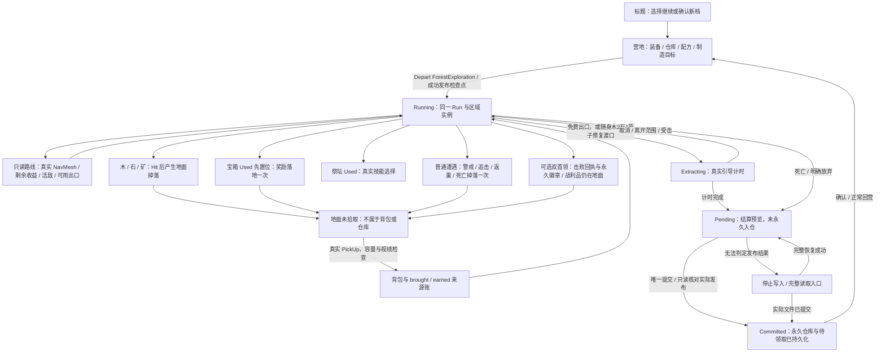

# 实际森林玩法与状态图

源码基线 `3b14dca0c246abdc71f44c02c765716d989fb6b4`。本图是实现审计，不表示人工试玩通过。

恢复不重新出征：LoadProgress → 校验主/备与分页 → RestoreWorld(saved checkpoint) → Build(saved forest, false) → 恢复敌人/资源/事件/地面身份。新 Run 才运行 GeneratePlayable；后继 Run 仍须明确 ForestExploration。

## 空间与内容

七个固定业务 POI：入口、林地、矿脉、遗迹、精英哨站、祭坛、湖岸。连接图用于高层规划，真实路径来自当前 NavMesh；地面高度网格、深水实体边界、岩脊、岩石/树干和事件碰撞参与实际导航。主路线是无碰撞视觉标记，开放区域允许离路探索。Boss 不是免费出口的前置条件。

42 个资源节点：18 木、12 石、12 矿，固定 node ID；11 个普通/精英遭遇，新增布局另含两名 Boss；除入口外每个 POI 有一宝箱、一祭坛。两个免费出口与一个条件渡口。各实体玩法作用和支持状态逐行见 CONTENT_AUDIT.csv；运行坐标、可达路径和身份见每个样本的 content-nav.json。

## 身份、随机与物资边界

- Run.seed 是请求种子；layout.seed 是实际布局种子。有限重试/备用记录 requestedSeed、attempt、failures、fallback，审计不将不同种子伪装成原种子成功。
- revision 为布局合同；generationVersion/contentRevision 为 Run 内容版本；regionInstanceId 为本局区域身份，不与三者混为一谈。当前新双 Boss 森林 revision5、generationVersion8；旧布局按保存快照恢复。
- Placement/Rewards/Events 为现有隔离流；路线/目标/反馈只读，不推进随机状态或领取物品。视觉不承诺影响玩法。
- 拾取才改变随身及 earned；消耗先按来源账扣除。未拾取宝箱/敌人奖励留地，不自动入仓。
- 成功撤离提交 earned；死亡/放弃丢本局收益、归还受保护的剩余带入物。徽章/首次讨伐回执按既有独立 Boss 检查点保留，核心与武器实体仍遵守地面/拾取/损失规则。
- Pending 不等于已入仓；Committed 的满仓溢出进持久化 pending。制造复用真实营地合并材料支付事务，不直接编辑最终存档。

## 反馈审计

已有路线/目标详情、主次 E/H、真实费用、取消原因、保存失败和 Boss 攻击提示。默认 HUD 的教程、制造目标优先于通用探索文案；没有完整小地图，不能把路线详情称为地图。血量、药水、容量由 HUD/背包供玩家判断，当前路线评分不按血药量自动平衡风险。

确认的 WORLD-F01：核心制造缺口时，详情同时展示森林首领核心收益与“此森林无核心来源”。仅修正这一来源/可选挑战说明，不改掉落、成本、路线分数或存档。其他可发现性建议见 CONTENT_PROPOSALS.md，未擅自实现新方向系统。
